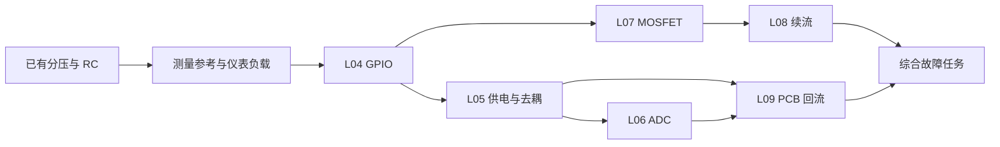

# 电路直觉实验室：后续工程实验调研与优先级报告

日期：2026-10-15  
对象：三年工作经验、硬件接触较少的嵌入式软件工程师  
应用方向：通用 MCU 控制板、传感器与通信接口  
历史调研基线：分压带载、RC、I²C 三案例 MVP 0.1。下文第 1–12 节保留当时的选题与可行性判断，不能作为当前交付清单。

## 实施进展与本轮补充

当前已推进到 MVP 0.4：L04–L06（GPIO、供电、ADC）与 L07–L09（MOSFET、续流、回流）已完成；本轮增加 L10 按键去抖与迟滞、L11 运放缓冲与饱和、L12 SPI 边沿与采样，已完成技术与流程验收。原始提案中的部分能力采用了范围更明确的教学等效模型，具体以各版模型和验收报告为准。

| 批次 | 已实现的教学能力 | 尚未包含的原始设想 |
|---|---|---|
| MVP 0.1，L01–L03 | 带载分压、RC 响应、单线开漏与双端测量 | 完整接口协议 |
| MVP 0.2，L04–L06 | GPIO 模式、R+C 供电瞬态、显式 ADC 采样与参考；仪表/探头加载 | ESR/ESL、真实 BOR、完整 ADC 内核 |
| MVP 0.3，L07–L09 | MOSFET 静态非线性、R-L 有界续流、预制回流接法 | 栅电荷/热、真实 TVS、PCB 电磁场与自动寄生提取 |
| MVP 0.4，L10–L12 | 反跳与迟滞、有限增益及输出饱和、实际采样前后窗口 | 随机接点/固件、运放共模及动态稳定性、完整 SPI 帧及传输线 |

本轮优先级依据：通用 MCU 数字输入、模拟传感器前端、通信接口各补一个常见工程判断；保持每课两类原因和可复查证据。UART 解码、LDO 动态、最小系统复位启动、RS-485/CAN 及更完整寄生模型继续按实际工作需求推进，没有因为列入候选而宣称已实现。

复查入口：[第三批调研与详细设计](./第三批实验调研与详细设计-v0.4.md)、[第三批验收](./信号调理与采样验收报告-v0.4.md)、[全部课程能力矩阵](./项目进展与课程能力矩阵.md)。历史交付：[v0.2](./扩展实验验收报告-v0.2.md)、[v0.3](./驱动与回流验收报告-v0.3.md)。数值验收与页面测试只能证明指定模型和流程，个人学习收益及实物能力仍需迁移任务和延迟复测。

## 1. 调研结论

**下一批最值得增加的是 GPIO 引脚电气、供电瞬态与去耦、ADC 采样与参考电压，并把测量方法作为贯穿三者的必修练习。**

第二批建议增加 MOSFET 低侧驱动、感性负载续流、PCB 回流与共用阻抗。这六个实验分别回答：

1. 软件配置了高电平，为什么引脚没有可靠的高电平？
2. 电源平均读数正常，为什么负载动作时仍可能异常？
3. 万用表测得正确，为什么 ADC 数字仍然不对？
4. GPIO 能输出电压，为什么不能直接或可靠地驱动负载？
5. 开关已经关断，为什么电感电流还需要通路？
6. 原理图连接相同，为什么 PCB 上的表现可能不同？

这个顺序是针对你的工作方向和现有 MVP 作出的工程判断，不是行业故障频率排行榜，也不是已经验证的个人学习收益排名。它优先补足软件与电气行为之间的联系，并复用你已经接触的分压、RC、开漏和双端测量。

若近期只扩展三个完整案例，建议选择 **L04 GPIO → L05 供电瞬态 → L06 ADC**。测量练习 M00 分别嵌入已有课程与新增课程，不另做一门大型仪器课程。PCB 的局部回路示意从 L05 开始出现，完整布局比较放到 L09。

## 2. 调研方法与可信边界

### 2.1 依据

本报告交叉检查了三类材料：

- **你的需求与既有设计**：重工程判断、轻复杂推导；面向 MCU、传感器、通信接口。
- **当前实际实现**：[MVP 验收报告](./MVP验收报告.md)、课程类型、测量函数、仿真适配器，以及固定版本内核中的相关元件源码。
- **厂商一手资料**：ST 的 GPIO、ADC 与 MCU 供电资料，TI 的施密特、感性负载及布局资料，ADI 的去耦、运放及 LDO 资料，Tektronix 的测量资料，以及 Nexperia 托管的 MOSFET 数据手册。资料清单见第 12 节。

选题依据是器件结构、应用约束和可观察的诊断行为；没有使用论坛个案推算普遍故障率，也没有用课程数量代表能力提升。

### 2.2 尚不知道的条件

目前没有你的真实故障清单、具体 MCU 型号、仪器条件，以及三案例的实际试学结果。因此：

- 按 3.3 V MCU、低压控制板、混合模拟/数字传感器作教学假设；不把 STM32 的引脚结构推广为所有 MCU 的结构。
- 优先级先服务于通用能力；若工作主要是工业长线通信，RS-485/CAN 应提前；若传感器全部为数字输出，UART/SPI 可先于 ADC 深入部分。
- 报告中的数值示例是明确条件下的量级核算，不是新实验的仿真实测。
- “实现复杂度”是当前平台条件下的相对估计，不是已经排定的开发工期。

## 3. 当前 MVP 覆盖了什么，还缺什么

已有三个案例提供了不错的起点，但还没有覆盖完整 MCU 板级分析。技术验收通过说明工具能运行、读数有核验依据；个人是否已经形成这些直觉仍需试学确认。

| 当前案例 | 已有训练内容 | 最值得接上的能力 |
|---|---|---|
| 分压带载 | 电压差、负载影响、支路电流、用操作区分同样的低电压 | GPIO 有限驱动能力、仪表负载、ADC 信号源阻抗 |
| RC 阶跃与脉冲 | 时间常数、建立过程、门限与脉宽 | 采样保持、去耦储能、迟滞与复位时序 |
| I²C 单线开漏 | 上拉、电容、边沿与灌电流的取舍 | 推挽与高阻、电平兼容、探头电容、其他接口的电气分析 |
| 共用取证流程 | 预测、双端测量、证据关联、迁移题、复盘 | 事件触发、同步比较、非理想测量、手册与实物迁移 |

现有 I²C 案例只覆盖开漏线的拉低与释放，不包含协议帧。已有 RC 门限也是教学假设，没有实际 MCU 输入或复位电路模型。后续课程应沿这些边界扩展，避免把已有内容误认为完整接口或最小系统仿真。

## 4. 候选实验比较与优先级

排序主要看四件事：与你工作的相关性、能否迁移到多个问题、能否设计有区分力的测量、现有平台能否可靠表达。可视化好看或实现容易只作为辅助因素。

“高/中”是定性评估。复杂度：低＝主要复用现有 R/C 与测量；中＝增加等效电路、事件测量或规则；高＝明显增加非线性核验、模型管理或空间呈现。

| 项目 | 工作相关性 | 能力迁移价值 | 当前实现复杂度 | 建议 |
|---|---|---|---|---|
| M00 测量参考、仪表负载与探头影响 | 高 | 高，影响所有实验 | 基础低，寄生振铃中高 | 贯穿必修；随课程分段增加 |
| L04 GPIO：推挽、开漏、高阻、上下拉、电平兼容 | 高 | 高，连接固件配置与真实引脚 | 中 | P0，下一批第一个完整案例 |
| L05 供电源阻抗、负载瞬态、去耦 | 高 | 高，连接电流、储能、时间与地 | 中；加入 ESL 后升高 | P0，下一批第二个完整案例 |
| L06 ADC：采样保持、源阻抗、参考电压 | 高，模拟传感器尤甚 | 高，连接软件采样设置与模拟电路 | 中高 | P0，下一批第三个完整案例 |
| L07 MOSFET 低侧驱动 | 高，存在执行器时尤甚 | 高，连接驱动、压降与功耗 | 中高 | P1，第二批 |
| L08 感性负载与续流 | 中高，取决于负载 | 高，建立电感和能量路径直觉 | 中高 | P1，紧随 L07 |
| L09 PCB 回流、共用阻抗与去耦布局 | 高 | 高，把电路连接落实到实物 | 高；受限布局比较可降低 | P1，概念在 L05 提前引入 |
| RC 扩展：按键弹跳与施密特输入 | 高 | 中高 | 中 | P1，小专题；不重复整个 RC 案例 |
| 最小系统：供电、复位、启动与调试条件 | 高 | 高，但原因较多 | 中高 | P1，先做手册和原理图检查任务 |
| UART/SPI 电平、采样时序、边沿与阻尼 | 高 | 高 | 电平中，传输线及时序高 | P2；近期接口排障多则提前 |
| 运放缓冲、放大与输入/输出范围 | 模拟传感器高，纯数字传感器中 | 高 | 中高 | P2；需要模拟前端时提前 |
| LDO 压差、功耗、热与启动 | 高 | 中高 | 静态中，动态和热高 | P2；先加量级判断卡 |
| RS-485/CAN 长线物理层 | 视产品而定 | 工业接口中高 | 高 | 按工作触发，分别建课 |
| 反灌电、热插拔与接口保护 | 高 | 高 | 基础反灌中，瞬态保护高 | 先在 GPIO 引入反灌路径；完整专题后置 |

相对原始十二实验建议，本次主要调整是：**提前 ADC 和供电，把仪器影响显式纳入，把 PCB 内容拆成早期回路示意与后期布局比较。** LED 闭合回路改为基础补课卡，按键弹跳作为 RC 扩展，减少重复学习。初期仍不扩展 RF、DDR、高速 USB 或复杂电源补偿。

## 5. 六个重点实验的建议内容

下面是供后续设计使用的实验定义。每个案例保持“一个主问题、少量变量、两类竞争原因、修复后验证”，避免在一个页面塞入所有知识。

### 5.1 L04：GPIO 引脚究竟在怎样驱动电路

**主问题：寄存器已经写 1，为什么引脚仍然不高，或者带载后变低？**

ST 的 GPIO 应用说明区分了推挽、开漏、输入与模拟配置，并讨论输入漏电、输出驱动和电平裕量；部分引脚的耐压条件还与模拟功能、供电状态相关。这些内容适合作为“软件模式背后的电路”入口。具体引脚仍必须查对应器件手册。[ST AN4899，Rev 4，2026-05](https://www.st.com/resource/en/application_note/an4899-stm32-microcontroller-gpio-hardware-settings-and-lowpower-consumption-stmicroelectronics.pdf)

**建议分为两个短任务：**

- 引导任务：把同一引脚切换为推挽高、推挽低、开漏释放、开漏拉低和输入高阻，观察内部通路与外部电流。
- 诊断任务：已知输出应为高，判断是模式/上拉问题，还是带载压降问题。电平兼容与掉电反灌先做工程迁移卡，避免首个案例过载。

| 项目 | 建议设计 |
|---|---|
| 最少电路 | 有限导通电阻的上下驱动开关、可选上拉/下拉、可切换外部负载、接收门限 |
| 可改变量 | 引脚模式、外部上拉、负载连接；进阶再加供电与漏电 |
| 核心观测 | 引脚对接收端地的电压、供电端电压、驱动支路电流、保证高/低区域 |
| 可视化 | 在简化引脚内部图中标出当前导通路径；模拟电压上叠加接收判定 |
| 必须形成的判断 | 高阻只是不主动驱动；开漏释放需要外部路径建立电平；负载与驱动能力共同决定电压 |

**诊断题对：**

- A：实际配置为开漏，外部上拉缺失；加入明确的弱漏电与寄生电容，不能让理想浮空节点被默认求解为 0 V。
- B：实际为推挽高，但负载过重、引脚高态压降明显。

二者都可能表现为“没有可靠高电平”。先移除外部负载，再接入已知弱测试上拉，并比较电压变化和驱动电流，才有区分力；只读输出寄存器或只测一次节点电压不足。

**迁移任务：**给出一页真实手册片段，让你分别找 VOH/VOL 的电流条件、VIH/VIL、引脚类型与注入电流限制，判断连接是否有保证。不得把绝对最大额定值当成推荐工作点。

**边界：**有限电阻是教学等效，不精确预测短路限流、损坏与温升。干扰和漏电必须显式设置；仿真不会自动产生真实环境噪声。

### 5.2 L05：电源正常，为什么负载一动作就异常

**主问题：电源接口测到 3.3 V，为什么 MCU 供电脚附近仍可能出现短时跌落？**

真实去耦不仅取决于电容量，还受 ESR、ESL 和连接路径影响；去耦回路的低电感连接很关键。ADI 的 MT-101 可支持这一机制，ST 的 MCU 供电资料则把它与芯片供电脚和复位条件联系起来。[ADI MT-101](https://www.analog.com/media/en/training-seminars/tutorials/mt-101.pdf)，[ST：MCU 供电设计基础](https://wiki.st.com/stm32mcu/wiki/Basics_of_power_supply_design_for_MCU)

**建议分两级完成：先 R+C，再显式加入路径 L 与电容寄生。** 第一版不需要完整 LDO 控制环路。

| 项目 | 建议设计 |
|---|---|
| 最少电路 | 电源、供电路径电阻、局部电容、静态负载与脉冲负载 |
| 可改变量 | 负载阶跃幅度/宽度、路径阻抗、局部电容；第二级增加 ESR/ESL |
| 核心观测 | 电源入口与负载端同步电压、最低电压、低于指定门限的持续时间、电容与供电支路电流 |
| 可视化 | 标出负载突变时各支路电流变化与瞬态回路；同步展示慢速平均读数和瞬态波形 |
| 必须形成的判断 | 稳态、瞬态和测量带宽是不同问题；电容暂时供给电荷，持续负载仍要由电源路径承担 |

**量级锚点，仅为独立计算：**额外 80 mA 流过 2 Ω，电阻压降为 0.16 V；若短时间完全由 10 µF 电容承担额外 80 mA，10 µs 内电压下降约 0.08 V。两项属于不同简化条件，不能直接相加后冒充完整电路波形。

**诊断题对：**

- A：线缆或连接器等效电阻偏大，负载持续增大时出现明显稳态压降。
- B：供电路径正常，但局部去耦缺失或连接电感偏大，负载边沿出现明显短时跌落。

两题都给出“动作时电压偏低”的现象。用同一触发事件比较入口与芯片端，并把短脉冲改为持续负载，检查跌落出现的时段与恢复方式。第一版保持单故障；综合题再允许同时存在两种问题。

**迁移任务：**在真实 MCU 原理图中找出每组供电脚、去耦和测点，并提出一次可执行的触发测量。复位判定需明确目标芯片 BOR/POR 门限、滤波与配置；教学门限越界只标为风险，不能直接等同于实际 MCU 必然复位。

**边界：**模型不预测具体稳压器的环路稳定性，也不根据示意线长自动得到真实寄生参数。电容变大可能带来启动和稳定性约束，课程不能给出“越大越好”的通则。

### 5.3 L06：万用表测量正确，ADC 为什么读不准

**主问题：信号电压看起来正确，为什么改变采样时间或通道顺序后读数会变化？**

ST 的 ADC 应用说明讨论了源阻抗、采样电容、采样时间及参考电压对结果的影响。它适合连接你熟悉的固件参数与动态负载，而不只是再讲一次分压。[ST AN2834，Rev 10，2024-10](https://www.st.com/resource/en/application_note/an2834-how-to-get-the-best-adc-accuracy-in-stm32-microcontrollers-stmicroelectronics.pdf)

**建议拆成两节：L06-A 采样建立；L06-B 参考与数字码。** 通道切换放在 A 的迁移任务中，不在最初同时叠加所有误差。

| 项目 | 建议设计 |
|---|---|
| 最少电路 | 戴维南信号源、源电阻、有限导通电阻的采样开关、采样电容、可设置采样窗口 |
| 可改变量 | 源阻抗、采样时间、前次电容状态；第二节改变参考电压 |
| 核心观测 | 源端电压、采样电容电压、采样结束时刻、建立误差、参考电压与推导数字码 |
| 可视化 | 明确“接入充电—断开保持”两段，在采样结束处画事件标记 |
| 必须形成的判断 | 高阻信号源可能带不动瞬时采样负载；采样时间与转换/调用间隔不能混为一谈；数字码取决于输入与参考的比例 |

**量级锚点：**12 位、3.3 V 满量程的理想 LSB 约为 0.806 mV；满量程阶跃只建立到 99%，剩余误差仍约为 41 LSB。“波形看起来接近最终值”未必满足目标精度。这是理想量化尺度，不是对某款 MCU 有效位数的承诺。

**诊断题对：**

- A：源阻抗高，采样窗口过短，保持电压未充分建立。
- B：采样已经充分建立，但参考电压与软件使用的参考值不一致。

二者都可以表现为换算结果偏差。分别延长采样窗口、比较源端与保持端，并检查参考电压。A 对采样窗口敏感；B 的比例误差不会仅靠延长窗口消失。不能把所有偏差都归为“加平均次数不够”。

**迁移任务：**高、低电压通道交替采样后，预测下一次采样初始状态的影响；再比较“输入与参考同源的比率测量”和“独立绝对电压测量”。同源变化可能部分抵消，不应教成参考电压变化必然带来同方向误差。

**实现上的关键发现：**当前固定版本内核的 `ADCElm.execute()` 直接按输入/参考比例生成数字结果，没有本实验需要的采样开关与保持电容。因此需要搭建显式等效电路，从求解得到的采样结束电压推导数字码，并声明量化规则。直接使用现成 ADC 图标会漏掉本课核心现象。[固定版本 ADC 源码](https://github.com/pfalstad/circuitjs1/blob/8ee04b18a6c9241675f1c4f766617806c2fe148d/ts/ADCElm.ts)

**边界：**不仿真完整 SAR 内部转换、INL/DNL、校准、真实噪声或全部芯片通道结构。源阻抗限值、采样电容及寄存器周期必须对应所选器件资料，示范参数不能冒充通用 MCU 参数。

### 5.4 L07：GPIO 怎样可靠地控制 MOSFET 负载

**主问题：栅极相对地已经有电压，为什么负载仍然工作不正常？**

MOSFET 的阈值电压与指定栅压下的导通电阻是不同规格。例如 NX3008NBKT 手册在 250 µA 条件下定义阈值，同时分别给出其他栅压和漏极电流条件下的导通电阻。这可以直接用来练习“看参数的测试条件”。该器件仅作为读手册例子，不是本报告的选型推荐。[Nexperia 托管：NX3008NBKT，表 7](https://assets.nexperia.com/documents/data-sheet/NX3008NBKT.pdf)

| 项目 | 建议设计 |
|---|---|
| 最少电路 | 3.3 V 有限驱动、栅极电阻与下拉、N 沟道 MOSFET、独立负载电源、先用电阻负载 |
| 可改变量 | 栅源电压、负载、驱动状态、源极回路阻抗；动态部分再加显式栅电容 |
| 核心观测 | VGS、VDS、负载电流、器件耗散；动态时观察栅极电流 |
| 可视化 | 同时显示控制回路和负载回路，突出它们的参考点与能量来源 |
| 必须形成的判断 | 控制量是 VGS；达到阈值不等于满足所需导通能力；栅极稳态电流小不代表开关瞬间无需驱动电流 |

**量级锚点：**栅极对板上参考点为 3.3 V，源极却为 2.5 V，则 VGS 只有 0.8 V。不能只测栅极对远端地就断言驱动充足。

**诊断题对：**

- A：栅源驱动不足，导通压降较大。
- B：VGS 正常，但负载电源路径阻抗大，负载端电压偏低。

同时测 VGS、VDS、负载入口电压，再检查电压落在哪一段。只看到“负载电流小”不足以区分。

**迁移任务：**复位期间 GPIO 高阻时，下拉怎样影响默认关闭；将低侧电路误改成简单高侧源极跟随器时，为什么参考关系改变。高侧完整驱动方案另设专题。

**边界：**当前内核存在 MOSFET 及可选栅电容模型，但尚未核验本课电路。简单模型不能用于真实器件损耗、雪崩可靠性与温升预测；固定电容也不等于完整非线性栅电荷模型。静态耗散可显示，结温需另有热模型与边界条件。

### 5.5 L08：感性负载关断后的电流到哪里去

**主问题：继电器或线圈断电后，为什么开关两端会出现高电压？**

TI 的感性负载说明比较了不同钳位/续流路径。普通续流二极管降低钳位电压，但可能延长去磁时间；更高钳位会改变释放速度和器件应力。该权衡适合培养电感与能量直觉。[TI SNVAA45：感性负载放电](https://www.ti.com/document-viewer/lit/html/SNVAA45)

| 项目 | 建议设计 |
|---|---|
| 最少电路 | 在 L07 基础上，把电阻负载换为串联 R-L；比较续流二极管与有界高压钳位 |
| 可改变量 | 电感、关断前电流、保护路径与钳位电压 |
| 核心观测 | 电感电流、开关两端峰值、保护支路电流、衰减到指定比例所需时间 |
| 可视化 | 分别画出导通与关断后的闭合路径，保持电流方向连续，允许电感两端电压反向 |
| 必须形成的判断 | 有限电压下电感电流不能瞬间归零；关断后的储能需要释放路径；保护与释放速度存在取舍 |

**量级锚点：**20 mH、100 mA 对应的储能约为 0.1 mJ。这个值用于检查能量量级，不能直接推断某只二极管或 MOSFET 的重复脉冲承受能力。

**诊断题对：**

- A：关断时没有有效续流支路，仅由显式寄生电容与有界备用钳位承接，开关电压高。
- B：有普通续流二极管，开关电压受限，但电流下降较慢。

同时检查关断电压、电流衰减和保护支路，判断需要解决的是应力还是释放时间。第一版不承诺两题波形完全相同，而是要求面对“关断行为异常”选择能明确问题的测量。

**迁移任务：**比较普通二极管与较高电压钳位方案，说明电压应力和电流衰减速度怎样改变；真实继电器的机械释放时间不能直接等同于电流衰减时间。

**边界：**禁止用“理想电感＋瞬间开路”得到无穷电压并当作真实尖峰。缺保护场景必须显式加入承接电流的寄生或钳位。暂不模拟电弧、磁饱和、二极管反向恢复及精确雪崩损坏。

### 5.6 L09：同一原理图，PCB 为什么可能表现不同

**主问题：导通检查都正确，为什么大电流动作会干扰传感器？**

TI 的布局说明讨论了回流路径、参考平面缺口和环路面积，以及快速边沿与信号完整性的关系。适合用来建立初步审图能力，但不能把路径示意当成真实电流密度计算。[TI SCAA082A，§1.6、§2.3–2.5](https://www.ti.com/lit/an/scaa082a/scaa082a.pdf)

**建议分两级，而非一次实现整套 PCB 仿真：**

- L09-A：先比较负载回流与传感器参考地是否共用一段阻抗，使用明确的集中参数模型定量观察。
- L09-B：再比较去耦回路、参考平面缺口和换层回流，用预制板图与条件化路径示意解释。

| 项目 | 建议设计 |
|---|---|
| 最少电路/布局 | MCU、传感器、大电流负载；预制两种回流连接；显式公共 R/L |
| 可改变量 | 共用/分开的回流连接、去耦连接路径；进阶再比较参考层连续性 |
| 核心观测 | 传感器局部输出、MCU 输入、两处地之间电压、与负载事件的时间关系 |
| 可视化 | 原理图、局部板图、等效电路三者联动；标出模型中使用的寄生参数 |
| 必须形成的判断 | 地线有阻抗；两处 GND 不保证瞬时等电位；既要看信号去路，也要看回路 |

**诊断题对：**

- A：传感器相对本地地输出稳定，但大电流共用回路让 MCU 看到参考偏移。
- B：传感器与 MCU 参考地正常，但传感器自身供电或输出受到干扰。

分别测传感器输出对本地地、MCU 输入对 MCU 地，以及两个地之间的电压，并同步到负载事件。只在 MCU 端看到噪声，无法确定噪声从哪里来。

**迁移任务：**对照一块真实板的原理图与 PCB，圈出负载回路、去耦回路和可用测点，提出一项布局修改及预期可测变化。

**边界：**两个布局若只映射到相同的理想网络，CircuitJS 不会自动产生差异；必须加入显式且有依据的寄生模型。路径箭头是示意，不给出 EMC 合格结论。也不采用“模拟地和数字地永远分割”或“回流永远走最短路”的通则。

## 6. M00：测量方法应怎样贯穿课程

这部分对你的帮助可能非常大：它训练的是“读数能否支持结论”。建议每次 5–10 分钟，逐段引入，不先讲完整仪器理论。

Tektronix 的探头教程指出，探头的电阻、电容和接地引线电感会影响电路或波形。高阻节点和快速边沿尤其需要考虑这些影响。[Tektronix：ABCs of Probes](https://www.tek.com/en/documents/whitepaper/abcs-probes-primer)

| 子练习 | 接入位置 | 亲手比较 | 形成的习惯 |
|---|---|---|---|
| M00-A 参考点与仪表负载 | 分压课与 L04 | 理想探针、有限输入电阻；换参考点 | 先说明测量的两个端点，考虑仪表是否改变电路 |
| M00-B 触发与时间窗口 | RC 与 L05 | 相同电路的稳态读数、短窗口、正确触发 | “没有看到事件”不等于事件不存在 |
| M00-C 探头电容 | I²C 与 L06 | 接入不同显式电容的探头模型 | 探头也可能改变边沿或高阻节点 |
| M00-D 接地引线与测量回路 | L09 或后续边沿专题 | 长引线/短地弹簧的等效模型 | 先排查测量回路，再把振铃归因于被测板 |

**一个足够直观的基础题：**3.3 V、上下各 1 MΩ 的分压器，理想空载为 1.65 V；接入 1 MΩ 仪表模型后为 1.10 V，接入 10 MΩ 后约为 1.571 V。计算条件明确，能直接复用现有“带载分压”认知。这里的输入电阻是教学预设，实际数值查仪器手册。

基础数字万用表模型和完整示波器模型不应混在一起：前者先说明输入电阻与平均读数，后者再加入输入电容、带宽和接地回路。带宽限制或抽样效果若没有真实实现，只能作为说明，不能伪装成求解结果。

实物任务可先使用已有的低压开发板和万用表；有示波器再做瞬态迁移。普通接地式台式示波器的地夹应按仪器规定接参考地，不能照搬软件中任意选择黑表笔的操作去夹高侧节点。高侧/浮地测量留到具备相应探头与操作条件时。

## 7. 其他实验的取舍依据

### 7.1 按键、施密特与复位：值得做，但要拆开问题

RC 之后增加“慢边沿叠加干扰，数字输出为何反复变化”的短专题，展示上下不同翻转门限。施密特能改善此类输入，但不是任意噪声的消除器，且具体输入要求要查手册。[TI SCEA046B，2025-04](https://www.ti.com/lit/ab/scea046b/scea046b.pdf)

复位另做最小系统任务：依次检查供电、复位、启动条件和调试连接，再根据器件选择时钟检查。不能把“加 RC”作为统一修复，也不能在没有时钟模型时显示振荡器启动波形。ST 的硬件开发说明可以作为真实原理图阅读材料，其建议只适用于所列器件。[ST AN4488：STM32F4 硬件开发](https://www.st.com/resource/en/application_note/an4488-getting-started-with-stm32f4xxxx-mcu-hardware-development-stmicroelectronics.pdf)

### 7.2 UART/SPI：先补电气与时序，再补协议内容

既有 I²C 不代表通信接口已经学全。下一层应比较输出电平与输入要求、共地、接收端波形、采样时刻，以及有限边沿下的延迟与过冲。串联电阻实验需同时展示振铃和建立时间，不能教成固定阻值处处适用。快速边沿的影响不能只按波特率或时钟频率判断。[TI：High-Speed Layout Guidelines，§1.2–1.3](https://www.ti.com/lit/an/scaa082a/scaa082a.pdf)

暂不开发完整协议分析仪。已有嵌入式经验可以用于解释协议层，工具重点补你目前更欠缺的电气证据。若近期工作集中于 SPI 屏幕、传感器或 UART 模块，这项可调入下一批。

### 7.3 运放前端：模拟传感器场景下应提前

优先做缓冲器与一个同相放大器，改变输入范围、增益、负载和供电，检查是否满足共模范围与输出摆幅。不要只展示“虚短”而隐藏器件限制。单电源放大器仍需关注输入、输出的裕量。[ADI：Design Trade-Offs for Single-Supply Op Amps](https://www.analog.com/en/resources/technical-articles/design-tradeoffs-for-singlesupply-op-amps.html)

如果你的传感器主要输出微弱模拟量，运放可提前到 L06 之后；若主要为 I²C/SPI 数字传感器，则先完成前六个重点实验。

### 7.4 LDO 与电源：先做简单且可验证的边界

先做输入不足、带载压降和功耗量级。例如理想忽略静态电流时，12 V 降为 3.3 V、输出 100 mA，器件耗散约 0.87 W；不能只因为电流不到额定值就认为热设计成立。真实 LDO 的启动、反向电流、限流和热保护具有器件差异。[ADI：LDO Application Tutorial](https://www.analog.com/en/resources/technical-articles/lowdropout-linear-regulator-ldo-application-tutorial.html)

静态判断可先做成 L05 的资料卡。输出电容稳定性、环路与热行为需要匹配模型或实测，再决定是否引入厂商 SPICE，不宜用一个理想稳压源替代后声称已学会 LDO 动态。

### 7.5 RS-485/CAN：由产品方向触发

RS-485 可围绕差分与共模、端接、支线和空闲状态建立实验。TI 的设计指南直接覆盖这些问题。[TI SLLA272D：RS-485 Design Guide](https://www.ti.com/lit/an/slla272d/slla272d.pdf)

CAN 应根据其自身收发器与总线条件另行调研，不能把 RS-485 的偏置与故障模型直接套用。如果工作很少接触工业长线接口，当前优先收益低于 GPIO、供电与 ADC；反之可提前。

### 7.6 反灌电、保护与热插拔：基础路径提前，完整验证后置

可先在 GPIO 迁移中解释“一个模块掉电后，信号仍使其电源轨抬升”的路径；并比较具有掉电保护能力与普通钳位路径的等效模型。是否存在该路径、允许电流和掉电条件必须对应具体器件，不能假设所有输入均有同样的上钳位二极管。[TI：Ioff 与掉电保护](https://www.ti.com/document-viewer/lit/html/SSZTAP0)

ESD、TVS、浪涌和热插拔的完整实验需要波形源、寄生、器件模型与实测依据。基础可视化可以帮助理解，但不能给出接口已通过保护验证的结论。

## 8. 推荐学习路径与综合任务

### 8.1 先形成三个分析习惯

建议先训练三个动作：

1. 看见异常先给出至少两个原因，写出它们预期的不同测量结果。
2. 测量前说明端点、参考、触发与正常量级。
3. 每次只改变一个条件，修复后用同一条件复测，再说明尚未排除的原因。

图中顺序是建议前置关系，不需要等到整个课程库完成才开始学习。首批每课安排两次短练习：先引导，隔天再做隐藏原因的诊断与迁移；实际时长根据试学调整。

### 8.2 综合任务：输出动作后，传感器读数异常

构造一块简化 MCU＋传感器＋MOSFET 负载控制板。先提供单故障任务，再升级为两项问题并存。候选原因包括供电路径压降、共用地阻抗、采样建立不足和驱动不足。

| 观测 | 首先支持或削弱的解释 | 下一步验证 |
|---|---|---|
| 负载动作时 MCU 供电脚电压明显下降 | 支持供电路径或去耦问题 | 同步比较入口/负载端，改变负载持续时间 |
| 传感器对本地地稳定，两个地之间出现偏移 | 支持公共回流影响 | 改变回流路径，复测差值与读数 |
| 供电与参考稳定，延长采样窗口后误差减小 | 支持采样建立不足 | 降低源阻抗或比较保持节点 |
| 负载电源正常，VDS 大且 VGS 不足 | 支持 MOSFET 驱动问题 | 纠正驱动条件，复查负载电流与压降 |

以上观测只在教学模型所列候选原因内形成诊断依据，不自动证明实物只有一个原因。真正的完成目标是你能提出这张测量表，并用证据逐步排查。

## 9. 当前平台实现可行性与必要改动

### 9.1 总体判断

**路线 C 仍适合继续使用，暂不需要更换通用仿真内核。** 新实验先采用受限等效电路与固定预设。对电源环路、精确热行为、特定器件非线性、完整信号完整性等需求，再单独评估厂商 SPICE 或实测数据。

本轮是源码静态检查，不是新案例的数值验收。内核存在某种元件，只说明有实现入口，不能说明它已经准确覆盖本课目标。

| 实验 | 复用基础 | 必须先验证的项目 | 初步可行性 |
|---|---|---|---|
| GPIO | 开关、电阻、门限、双端电压 | 浮空处理、有限驱动、不同模式及功耗方向 | 高，可先完成受限模型 |
| 供电 R+C | 现有 RC 与支路捕获 | 负载事件、最低值、恢复与持续时间 | 高，适合作为第一层模型 |
| 供电 RLC/寄生 | 电感与电容元件 | 快速边沿、振铃、步长收敛与窗口预算 | 中，需独立数值预研 |
| ADC | RC、开关、事件取样 | 采样/保持时序、初始状态、量化与参考规则 | 中高，不能直接用理想 ADC 元件 |
| MOSFET | MOSFET、驱动开关 | 模型参数、VGS/VDS、支路方向、非线性收敛 | 中，先静态后动态 |
| 感性负载 | R-L、二极管、钳位 | 关断时的有界路径、峰值与能量量级 | 中，模型边界必须明确 |
| PCB | 双端测量、预制布局 | 图形到等效参数的映射及因果说明 | 示意＋集中参数可行，场计算不在范围内 |

### 9.2 不能仅“往内容文件加几道题”

检查当前代码发现以下扩展点：

| 当前情况 | 对新课的影响 | 建议改动 |
|---|---|---|
| `LessonId` 固定为三项，参数为三课共用结构 | 新课参数和校验容易互相干扰 | 按课程定义参数、预设与校验，保持类型约束 |
| 测量主要为电压、电流、峰值与 I²C 上升时间 | 缺最低值、门限持续时间、采样时刻、衰减时间 | 增加有事件区间的通用测量，记录门限与算法版本 |
| I²C 的上升时间函数绑定 BUS/CTRL 与固定门限 | 不能直接用于不同电源或其他接口 | 将事件、测点与门限作为课程配置 |
| 适配器当前只接受电阻支路映射 | 新课要读电容、电感、MOSFET 等电流 | 建立允许的元件映射及电流方向核验；不能直接取消类型检查 |
| 单次捕获上限为 100000 样本、15 秒墙钟超时 | 纳秒边沿与毫秒动作放在同一窗口可能超预算 | 分开事件窗口，先估步长和样本预算；不盲目扩大上限 |
| 存储固定为 schema 1、课程版本 0.1 | 新增课程、证据种类后可能影响旧记录 | 加兼容迁移，保留旧课进度和证据 |
| 目前历史波形在内存、刷新后重新求解 | 新课仍需区分历史证据与当前仿真 | 继续保留 runId、模型版本、参数和时间条件 |

核对位置：[课程与记录类型](../src/types.ts)、[测量函数](../src/measurement.ts)、[仿真适配器](../src/simulation/adapter.ts)。

需要保留的已有机制包括：先预测、再取证；诊断参数隐藏；每次参数改变重新求解；真实求解数据与解释卡区分；证据保存运行条件。新增数字码、功率等派生值也应注明计算依据。

### 9.3 先做小范围技术验证

每个新模型进入课程前至少完成：

1. 标称、边界和两个故障预设可以稳定求解；节点和电流方向明确。
2. 选两个以上关键量，用独立量级计算或可追溯资料交叉检查。
3. 对最敏感瞬态减半步长，验证读数与诊断结论稳定；容差按模型另定。
4. 两个候选原因确实能被设计的测量区分；无效证据不能获得充分取证评价。
5. 图、波形、数字和判分来自同一运行条件；工程假设与未模拟因素可见。

当前三案例已有的 102 项数值检查不能作为这些新模型的验证依据。

## 10. 如何判断实验确实对你有帮助

不能只统计完成率或是否记住题目答案。建议用个人前测、课后迁移、延迟复测和一项实物/资料任务评价。

| 时点 | 任务 | 记录内容 |
|---|---|---|
| 学前 | 看一个没见过的同类异常，列原因和测点 | 是否先猜单一原因、测量目的、置信度 |
| 学后 | 换参数、画法或参考点，完成诊断 | 是否会预测方向，是否选择有区分力的证据 |
| 约一周后 | 不看提示，完成新变体 | 概念是否保留，是否依赖记题 |
| 工程迁移 | 在真实原理图/手册上找相关节点和规格；有条件再实测 | 能否把仿真假设对应到真实约束 |

建议继续使用四项、每项 0–2 分的评价：原因与趋势、测量目的、证据解释、修复与边界。新课将“独立通过”设为：总分至少 6/8，测量目的和证据解释均得 2 分，且没有使用直接揭晓提示。它是本项目的教学标准，不是行业能力认证。

课程内通过后，还应完成一道未见迁移题和一项资料/实物任务。时间只作为学习负担指标，不奖励为了快而少测。单人学习不声称有统计显著的提升比例。

若出现“课内满分，换一张图就不会测”，优先改题目和引导；若已能稳定完成迁移，就缩短重复练习，把精力转向实际工作问题。

## 11. 建议的下一步范围

**下一版建议交付：三个新案例＋贯穿测量练习＋一个简化综合诊断。**

| 内容 | 纳入程度 |
|---|---|
| L04 GPIO | 完整闭环；电平兼容与反灌先做迁移卡 |
| L05 供电与去耦 | 先完成 R+C、负载事件与入口/芯片端对比；RLC 通过预研后再纳入 |
| L06 ADC | 分采样建立与参考两节；显式采样保持模型 |
| M00 | 先做参考点、输入电阻和触发；探头寄生按相应模型逐步加入 |
| 综合任务 | 首版使用单故障；复用已验证模型 |
| PCB | 在 L05 加局部回路示意；完整布局对比列入第二批 |

第二批再完成 L07–L09。按键/施密特和最小系统资料任务可穿插进行；UART/SPI、运放、LDO 与工业总线根据实际工作调整。

实施前最有价值的补充信息是：你在现有三课中实际卡在哪里，以及工作里最近遇到过的一两个电气问题。这些信息用于修正排序，不妨碍先确定上述基础方向。本报告没有据此启动开发或改变现有 MVP。

## 12. 主要资料与复查入口

以下均为厂商原始资料或官方托管文档；检索于本次调研期间，报告整理截至 2026-10-15。版本只在实际文档中核实后注明，动态网页可能更新。章节/页码帮助定向阅读，无需按顺序通读。

| 资料 | 优先阅读位置 | 支持的选题 |
|---|---|---|
| [ST AN4899，Rev 4，2026-05](https://www.st.com/resource/en/application_note/an4899-stm32-microcontroller-gpio-hardware-settings-and-lowpower-consumption-stmicroelectronics.pdf) | §4 引脚结构与配置；§5 电气定义；§6 硬件指南 | GPIO、电平、输入状态与供电边界 |
| [ST AN2834，Rev 10，2024-10](https://www.st.com/resource/en/application_note/an2834-how-to-get-the-best-adc-accuracy-in-stm32-microcontrollers-stmicroelectronics.pdf) | §3.2 参考与外部误差；§4 采样与精度，尤其高阻源相关段落 | ADC 采样建立、参考与误差 |
| [ST：Basics of power supply design for MCU](https://wiki.st.com/stm32mcu/wiki/Basics_of_power_supply_design_for_MCU) | 去耦、PCB 建议与供电监控部分 | 供电、复位与原理图迁移 |
| [ADI MT-101：Decoupling Techniques](https://www.analog.com/media/en/training-seminars/tutorials/mt-101.pdf) | 实际电容等效与低电感去耦路径 | 去耦、ESR/ESL、连接回路 |
| [Tektronix：ABCs of Probes](https://www.tek.com/en/documents/whitepaper/abcs-probes-primer) | Loading、Ground Lead、Determining the Source of Aberrations | 仪表负载、探头电容与引线影响 |
| [NX3008NBKT 数据手册，Rev 1，2011-08](https://assets.nexperia.com/documents/data-sheet/NX3008NBKT.pdf) | 表 7；导通电阻与栅压曲线 | MOSFET 规格的测试条件阅读 |
| [TI SNVAA45](https://www.ti.com/document-viewer/lit/html/SNVAA45) | 概述中不同放电路径的比较 | 续流、钳位与去磁时间 |
| [TI SCAA082A，2017-08](https://www.ti.com/lit/an/scaa082a/scaa082a.pdf) | §1.2–1.3、§1.6、§2.3–2.5 | 边沿、传输线、回流与布局 |
| [TI SCEA046B，2025-04](https://www.ti.com/lit/ab/scea046b/scea046b.pdf) | 第 1–2 页：慢边沿、迟滞及门限 | 按键与施密特扩展 |
| [ST AN4488，Rev 7，2018-10](https://www.st.com/resource/en/application_note/an4488-getting-started-with-stm32f4xxxx-mcu-hardware-development-stmicroelectronics.pdf) | 供电、复位、启动与调试部分 | 真实最小系统检查任务 |
| [ADI：Design Trade-Offs for Single-Supply Op Amps](https://www.analog.com/en/resources/technical-articles/design-tradeoffs-for-singlesupply-op-amps.html) | Input Stage Concerns 与输出级相关段落 | 运放输入共模、输出裕量 |
| [ADI：LDO Application Tutorial](https://www.analog.com/en/resources/technical-articles/lowdropout-linear-regulator-ldo-application-tutorial.html) | 启动、反向电流、限流与热保护 | LDO 的器件边界 |
| [TI SLLA272D，2021-05](https://www.ti.com/lit/an/slla272d/slla272d.pdf) | §6 端接/支线；§7 Failsafe；接地与隔离 | RS-485 条件性扩展 |
| [TI SSZTAP0：Ioff 与掉电保护](https://www.ti.com/document-viewer/lit/html/SSZTAP0) | 掉电路径与保护特性说明 | GPIO 反灌电迁移 |

内部基线：[原需求分析](../需求分析与方案选型报告.md)、[详细设计 v0.1](../详细设计-v0.1.md)、[项目计划 v0.1](../项目计划-v0.1.md)、[MVP 验收报告](./MVP验收报告.md)。既有设计用于说明目标，当前交付状态以验收报告和源码为准。
