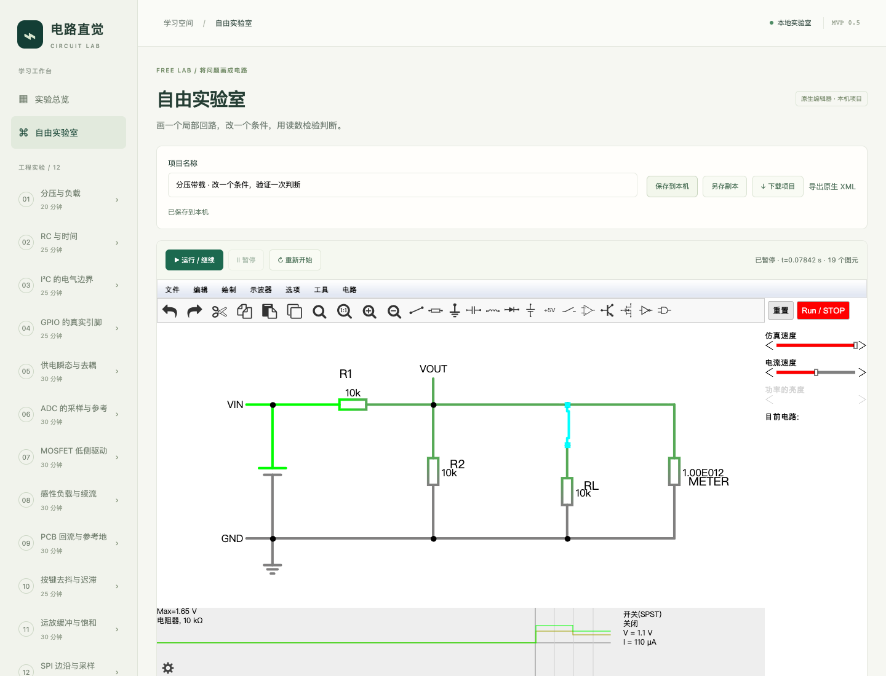

# 自由实验室 MVP 0.5 验收报告

日期：2026-10-15。决策基线：方案 B“原生编辑器 + 中文项目工作台”，C1–C8 全部按推荐约定确认。

## 交付结论

自由实验室已集成到现有工作台，完成“画图 → 运行 → 看读数/波形 → 改一个条件 → 保存 → 重开复测”的独立闭环。十二课、24 个诊断挑战和 24 道迁移题继续保留；课程数据仍为 0.4/schema 4，应用版本为 0.5.0。沙盒项目使用独立 IndexedDB/schema 1，不参与课程评分。

生产入口：[本地实验室](http://127.0.0.1:4173/)，左侧“自由实验室”。离线使用随包本地资源；启动方式为 `npm start` 或双击 macOS `启动实验室.command`。交付包及校验记录在 `releases/`，包中不包含个人浏览器项目。

## 已确认需求与结果

| 约定 | 当前结果 |
|---|---|
| C1 中文工作台 | 中文项目、运行状态、保存反馈、帮助及常用属性；保留原生编辑器和高级英文选项 |
| C2 局部电路 | 可放置、连线、编辑、删除、撤销重做；基础 R/C/L、源、地、导线、开关、二极管、受控开关通过代表电路核验 |
| C3 原生观察 | 原生元件读数和示波器；右键增加示波器后保存、重开，配置保持一致 |
| C4 运行语义 | 电气设计修改暂停并要求重新开始；开关为连续激励；纯布局、文字及布局撤销重做保留本次电气状态 |
| C5 重开语义 | 保存设计、模型、显式初始条件、当前开关、示波器和笔记；重开暂停且 t=0，不恢复历史曲线或运行断点 |
| C6 本机项目 | 自动保存、手动保存、另存、删除、JSON 备份、XML 导出、JSON/XML/经验证旧文本导入；导入分配新 ID；真实事务提交后才显示已保存 |
| C7 课程衔接 | 空白、分压、RC、开漏模板；前三课正常实验的当前参数可复制；诊断无直接复制入口，笔记可选 |
| C8 本地桌面 | Chromium 主验收、WebKit 交叉检查；1280/1440 桌面宽度无横向溢出；不承诺手机与特定发行版 Safari |

沙盒运行预算为 1–200 个顶层图元，图元包含导线、地和文字。导入最多 500 个图元，XML 最多 3000 个后代节点，文件/项目上限 1 MB（UTF-8）。每段连续运行 60 秒后暂停，可继续同次运行。预算是产品约束，不代表任意 200 图元电路都能快速求解。

## 数值与模型验收

固定内核提交：`8ee04b18a6c9241675f1c4f766617806c2fe148d`。实际读数均来自内核。参考值由独立分压/KCL、一阶指数方程、指定二极管模型的负载线求交得到；不以页面显示自身作为正确性的唯一依据。

| 代表电路 | 参考与实际结果（Chromium） | 判断 |
|---|---|---|
| 3.3 V，10 kΩ+10 kΩ | 输出 1.650000 V，支路 165 µA；再并联 10 kΩ 负载为 1.100000 V | 与解析结果一致，鼠标实搭亦通过 |
| 10 kΩ、1 µF RC | t=10.010 ms 时 2.086605 V，解析 2.087211 V，差约 0.607 mV；半步长结果差约 0.303 mV | 满足 3 mV/2 mV 验收容差 |
| RC 初始条件 | 显式 1.2 V 初值按指数过程核验；保存不带运行 `vd`；重开 t=0 后结果可复现 | 通过，初始条件与断点分开 |
| 100 Ω、0.1 H RL | 初始 2 mA，约 1 ms 时实际 21.590 mA、解析 21.596 mA；保存不带运行 `i` | 误差约 5.7 µA，小于 40 µA |
| 原生通用二极管 | Is=1.7143528192808883e−7 A、n=2、Vt=0.025865 V；工作点 0.384832 V，KCL 一致 | 与此模型负载线求交一致；不能套用固定 0.7 V |
| 自定义二极管 | Is=1e−9 A、n=1.8；工作点 0.582550 V；中文模型定义/引用保存后重开仍相同 | 自定义模型往返通过 |
| 4.7 kΩ/100 pF 开漏 | 100 Ω 导通支路时低态 68.75 mV、灌电流 0.6875 mA；释放约 2.405 µs 时 3.015775 V、解析 3.023233 V | 释放误差约 7.46 mV，小于 10 mV；不等于协议验收 |

二极管反偏定性、无效数字、未知图元、缺失模型、损坏 XML、子电路库、零步长均有检查。自定义模型声明应位于使用处之前，遵循原生序列化顺序；首版不承诺兼容所有旧文本或其他仿真器格式。

50/200 图元的电阻样例通过，201 图元运行被拒绝；这是指定简单样例的规模核查。真实连续运行实测 60.010 s 后暂停，再继续保留 runId 和当前时间。理想电压源短接/闭环由宿主前置拒绝，未自动补入内阻；导线闭环显示内核错误。浮空、缺参考和不收敛的其他图仍需按实际模型分析，未报错不等于工程设计正确。

## 操作、数据与回归证据

| 验收集 | 结果 | 原始记录 |
|---|---|---|
| 沙盒内核 | Chromium 33/33，WebKit 33/33；启动模型创建错误为 0 | [Chromium](./沙盒内核核验-v0.5.json)、[WebKit](./沙盒WebKit内核核验-v0.5.json) |
| 空白手绘与文件闭环 | 两种浏览器各 6/6，页面异常为 0 | [Chromium](./沙盒流程核验-v0.5.json)、[WebKit](./沙盒WebKit流程核验-v0.5.json) |
| 操作与恢复 | 两种浏览器各 17/17，页面异常为 0 | [Chromium](./沙盒操作与恢复核验-v0.5.json)、[WebKit](./沙盒WebKit操作与恢复核验-v0.5.json) |
| 菜单/示波器/课程集成 | 14/14 | [集成记录](./沙盒菜单与课程集成核验-v0.5.json) |
| 连续运行预算 | 实际 60 秒自动暂停，并可同次继续 | [预算记录](./沙盒连续运行预算核验-v0.5.json) |
| 原有前三课数值 | 67 次捕获，102/102 | [结果](./课程回归-verifyEngine-v0.5.json) |
| GPIO/供电/ADC 矩阵 | 345 次，1189/1189 | [结果](./课程回归-verifyExtensions-v0.5.json) |
| 驱动/续流/回流矩阵 | 226 次，1146/1146 | [结果](./课程回归-verifyStages-v0.5.json) |
| 去抖/运放/SPI 矩阵 | 259 次，2044/2044 | [结果](./课程回归-verifySignals-v0.5.json) |
| 课程生产回归 | 26/26，外部运行请求和页面异常为 0 | [结果](./课程生产回归-v0.5.json) |
| 单元与构建 | 5 个测试文件、46 项通过；TypeScript 与生产构建成功 | `npm test`、`npm run build` |

原课程矩阵合计 897 次捕获、4481 项检查，在最终内核 JavaScript 上重新执行，不能转换为“任意沙盒电路已验证”。生产回归覆盖旧记录备份迁移、导入失败保护、导入导出、三课代表参数、波形回放、存储额度失败与恢复、本地资源及桌面宽度。

恢复检查实际注入 IndexedDB 写入额度错误，验证内存笔记可导出、恢复后可保存；两个窗口同项目写入发生 revision 冲突时，暂停自动写入并保留本地笔记，可另存独立副本。坏电路文件先在临时编辑器检查，失败不替换当前项目。纯布局撤销/重做测试中，RC 的 t=5.033333 ms、Vc=1.301780116 V 在操作前后完全一致。

## 关键实现与修复

项目模块为 `src/sandbox/`，桥接位于 `engine-overrides/SandboxBridge.ts`。桥接仅对 `sandbox=1` 启用；课程固定测点和元件下标不用于自由电路。

- 电气签名比较元件身份、参数与端口网络，区分坐标移动、重连和开关激励；同名标签参与连通关系。
- 使用不含运行状态的设计导出，额外保存示波器。纯布局撤销沿用元件对象，防止原生全文重载清空电荷与时间。
- 原生新建、导入、另存、文本导出和示例入口统一交给中文项目层；未集成的库管理、恢复、创建子电路与 DC 高级入口明确提示限制。
- 原生关闭提示交给宿主提交状态管理，避免已成功保存后重复提示未保存。原生恢复键不充当多项目库。
- 修正原生 Esc 后工具栏指针残留；补本地侧栏资源和常用中文；修正 Unijunction 启动注册顺序。没有修改器件方程、积分方法或矩阵求解。

来源与可复现改动见[第三方来源](./第三方来源.md)及 `public/vendor/circuitjs/provenance.json`。原始源码归档、许可证、覆盖文件和构建脚本一同保留。

## 使用建议与剩余边界

先完成一个课程正常实验，再复制到沙盒。写一个预测，只改变一个参数或连接，用读数验证；最后另存副本留下比较版本。观察前确认电压两端、电流方向、参考地、时间尺度和器件模型。图形颜色和动画速度不能代替数值证据。具体起步步骤见[使用指南](./自由实验室使用指南-v0.5.md)。

本版没有外层通用探针、历史曲线持久化、CSV、自动评分、固件联合仿真、PCB 布线、KiCad/SPICE 通用互导、账号和云同步。MOSFET/BJT/运放等原生器件可探索，但其所有型号和任意画法没有通过本批沙盒验收。50/200 图元样例不能证明复杂模型不卡顿；同源 iframe 不提供独立计算线程或硬中断保证。

页面隐藏时执行暂停和保存，返回不自动运行；离开并重开已在浏览器流程验证。强制结束浏览器、系统断电或存储被清除时，尚未成功提交的修改不能保证恢复。自动保存属于浏览器草稿，长期保留应下载项目文件。

自动化已验证规定的代表电路和操作路径；尚未进行用户试学、实物测量对照及延迟复测，不能由软件通过率推断学习收益或真实硬件可靠性。
