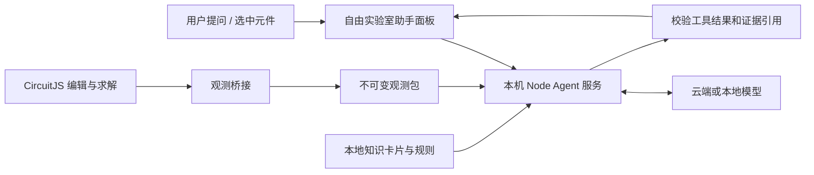

# 自由实验室 Agent：需求分析与技术方案

日期：2026-10-16。评估基线：MVP 0.5.0、原生 CircuitJS 编辑器、中文项目工作台与现有十二课。本文为新增需求分析和候选方案，未接入模型、上传电路或改动运行中的工作台。

## 1. 可行性结论

可以在当前架构中加入 Agent，帮助用户理解正在绘制和测试的电路。建议定位为**能读取当前电路证据的学习助手**：说明元件与回路作用、解释读数、提出候选原因、给出下一步测量和单变量实验建议。

主要新增工作是电路观测与证据组织，而不是聊天窗口。现有设计快照和内核 API 提供了基础，但尚不足以直接承诺“Agent 已掌握当前电路状态”。建议先形成只读闭环，再增加受控副本实验；模型提供商通过适配层选择。

这里的 Agent 指“模型可以按需调用应用提供的有限工具，并依据工具结果继续回答”。Agent 的编排服务可以运行在本机，语言模型可以在云端，也可以本地运行。这两项选择应分开讨论。

产品运行不应依赖本次开发对话常驻或开发者手工读取浏览器；需要应用自身的模型连接、工具权限和故障处理。

## 2. 用户真正需要的帮助

用户是软件经验较多、硬件基础较少的嵌入式工程师。回答应把抽象概念落到当前回路和操作上，逐步建立“先预测—再测量—再判断”的习惯。

| 用户问题 | 需要的依据 | 有用的回答 |
|---|---|---|
| 这段电路在做什么？ | 实际连接、元件值、输入、模型与用户目标 | 指出主要回路、输入输出和作用，标出条件 |
| 为什么这里是 1.1 V？ | 对应节点、参考地、同次读数、开关状态 | 结合负载分流解释，再给一个可验证的操作 |
| 为什么电流是负数？ | 测量支路、正方向、瞬态阶段 | 先说明方向约定，再解释实际能量或电荷流向 |
| 改大电容会怎样？ | R/C、输入波形、初始条件和时间尺度 | 给趋势预测，说明需要观察的窗口 |
| 为什么没有波形、为什么不能运行？ | 错误、运行状态、连接、示波器配置 | 区分未运行、配置问题、设计待重置和求解错误 |
| 这电路画对了吗？ | 用户期望功能、实际拓扑与约束 | 先明确目标；列出可确认事项和待验证事项 |
| 这会烧坏 MCU 吗？ | 具体芯片、绝对额定值、注入/驱动能力、真实模型 | 数据不足时说明缺口，指导查规格和测量，不能由简化仿真保证 |

“解释一下”和“引导我排查”可采用不同回答方式。默认先直接解答核心疑问，再提供一个短实验；用户选择引导模式时，再先问预测或给分层提示，不强制把每次提问变成答题。

建议答复结构：一句主要判断 → 本次电路证据 → 直观原因 → 一个验证操作 → 仍缺的条件。用到数值时注明是仿真实测、公式估算还是规格要求。

## 3. 当前架构核查

| 现有模块 | 已有基础 | 还缺什么 |
|---|---|---|
| `engine-overrides/SandboxBridge.ts` | XML 设计快照、运行状态、错误、runId、designRevision、stimulusCount；已有连通性签名 | 对外标准化观测接口、节点/端口/元件引用、采样与有效性、求解辅助处理说明 |
| `src/sandbox/adapter.ts` | 同源可编辑 iframe，生命周期独立于课程 | 类型目前未声明运行时已有的三个版本/激励字段；缺少统一观测类型和读取方法 |
| `src/sandbox/SandboxPage.tsx` | 项目、笔记、运行控制、200 ms 状态轮询 | 提问上下文冻结、聊天区、证据定位、过期提示、取消和故障降级 |
| `src/sandbox/model.ts` | 独立项目 schema 1、内核版本、来源、显式设计 | XML 没有持久化的通用元件 ID；当前图与历史回答如何对应尚未定义 |
| 内核 `JSInterface.ts` / `CircuitElm.ts` | 可读取元件类型、端口电压、电压差、电流；有逐步回调 | 标签查询不能覆盖任意未命名节点；缺少公开、稳定的连接与节点标识接口 |
| `src/simulation/adapter.ts` | 课程已有逐步采样和预算控制经验 | 依赖固定节点名与元件下标，不能直接作为自由电路测点系统 |
| 十二课内容与工程说明 | 已有基础概念、典型问题、模型边界和验证用例 | 需提炼为可检索的知识卡片，关联适用条件、来源和版本 |
| `scripts/serve.mjs` | Node 本地 HTTP 静态服务 | 当前只接受 GET/HEAD，没有 Agent API、模型配置、流式回答或工具编排 |

### 会直接影响回答正确性的源码细节

1. 内核 `SimulationManager.getLabeledNodeVoltage()` 找不到标签时返回 **0**；`CircuitElm.getVoltageJS()` 对超出范围的端口也可能返回 0。Agent 层必须先验证引用存在，未知值返回明确状态，不能把它转述为“测得 0 V”。
2. 内核在一些没有显式地的电路中，会把电源的一个端子设作参考；对部分未连接节点，会通过 **100 MΩ** 辅助电阻接到参考点以便求解。需要暴露参考来源和辅助处理，不能将可求解误解为原图已经有正确回路。
3. 当前宿主已拒绝理想电压源闭环，防止原生便利处理自动补入内阻。Agent 应读取这个实际错误，而不是根据原图假造正常电流。
4. 保存的 XML 刻意排除了电容/电感运行状态和历史波形。因此“项目文件”和“当前运行观测”必须分开读取；重开项目的 t=0 读数也不能自动当作稳态结果。
5. 当前 designRevision、元件 WeakMap 身份和内核节点编号都是运行上下文内的数据。数组下标、屏幕文字“R1”和跨重载节点编号，都不能单独作为长期证据主键。

以上是本地固定源码的核查结果，不是新增功能的运行验收。实际新增观测接口仍需专项验证。

## 4. 三条能力路径

下列编号仅用于本次 Agent 需求，不改变原先已选定的沙盒方案 B。

| 路径 | 做法 | 优点 | 局限与成本 | 建议 |
|---|---|---|---|---|
| 1：带电路上下文的问答 | 将设计、当前快照和相关知识交给模型回答 | 接入较快，可验证用户是否愿意使用 | 纯文本/XML 难以准确定位元件；不容易按需测量和核验 | 可作为技术样机，不能仅此宣称可靠分析 |
| **2：观测工具 + 规则 + 学习 Agent** | 提供结构化拓扑、有效读数、规则检查与知识检索；模型按需调用只读工具 | 能把回答和具体证据绑定，适合现有架构，可控制范围 | 要先补观测桥接、标识和有效性；仍需评估模型解释质量 | **推荐首版** |
| 3：可执行实验的 Agent | 在路径 2 上，提出修改、运行副本、比较结果 | 能回答反事实和验证候选原因，形成完整实验闭环 | 副本生命周期、初始条件、公平比较、预算与提交语义更复杂 | 后续阶段，先保证路径 2 |

推荐以路径 2 为目标，第一里程碑只完成“读取当前电路—回答一个问题—给出可核对的证据”。不需要先引入多 Agent、通用浏览器操作、微调或大型工作流框架。

## 5. 推荐架构与数据流

第一次提问时，由浏览器在已完成操作的边界读取一致的观测包，发给同源本机服务。服务保存本次请求的临时上下文，模型通过工具按需查询其中的图、读数和规则结果，不必每轮都重新上传整张图或全部波形。

**本机 Node 服务无法直接读取浏览器内存、iframe 状态或 IndexedDB。** 浏览器采集并提交观测是必需的一步。首版可让工具只查询这份不可变观测包，避免先建设后台常驻浏览器 RPC。后续主动捕获或副本实验，再增加明确的浏览器任务协议。

LLM 的函数调用是请求，应用负责执行、校验并返回结果；OpenAI 的官方流程也是由应用端执行工具。可以使用 Responses API 实现该循环，尚无必要先引入完整 Agent 框架。[OpenAI Function calling](https://developers.openai.com/api/docs/guides/function-calling)

### 5.1 建议的观测包

至少包含：

| 数据 | 需要明确的内容 |
|---|---|
| 身份与版本 | projectId、运行上下文 ID、内核/桥接版本、设计哈希、文档哈希、runId、snapshotId、激励序号 |
| 实际连接 | 元件 ID/类型/参数/模型、外部端口、网络 ID、标签、显式地与隐式参考来源 |
| 运行语义 | 运行/暂停/未运行、求解步是否完成、仿真时间、步长、待重启、错误与辅助求解处理 |
| 当前读数 | 电压的两端或参考节点、电流的正方向、单位、采样时刻、来源和有效性 |
| 已有曲线 | 测点、起止时间、样本数、是否完整、所用设计/运行/激励条件；没有记录就明确为空 |
| 提问意图 | 当前选中对象、用户期望功能、本次问题；笔记仅按选择附带 |

读取应在一个确定的同步或求解步边界完成，不能先拿新图、后拿旧读数。询问本身不应暂停、重启或改动主电路。若仍在拖动、属性对话框未完成或正在重分析，则返回“状态尚未稳定”，不悄悄拼装两份数据。

节点连接优先使用内核已解析的端口与网络映射，不让模型根据截图猜连接，也不单靠线条坐标重新推断路由。首批为已验证器件建立参数与方向适配器；多端器件没有验证过的端口电流应返回不支持，不能将单个 `getCurrent()` 当作所有引脚电流。

首版可采用“会话内元件 ID + 文档哈希”定位；重载后历史回答保留当时快照，不冒充仍能定位到新图。若需要跨会话高亮和可应用补丁，再设计项目中的持久化 ID 映射与迁移。

### 5.2 数据有效性与回答过期

至少区分：未运行、设计已变、已有有效采样、求解失败、窗口未完成、引用不存在、器件不支持。无效数值使用 `null` 和原因，禁止用 0 代替。

运行继续时，历史回答仍可以解释当时的观测，但应显示“依据 t=… 的快照”。设计改变、输入切换或新一轮运行后，提示当前状态已变化；新的数字结论必须绑定新证据。项目存储 revision 不能替代电气版本，它也会因笔记和布局保存而变化。

### 5.3 首版工具边界

| 工具候选 | 作用 | 执行位置/限制 |
|---|---|---|
| `describe_circuit(snapshotId)` | 返回元件、网络、参考与模型摘要 | 查询本次观测包 |
| `inspect_element(snapshotId, elementId)` | 返回选中元件参数、连接和有效读数 | 引用必须存在且属于本次上下文 |
| `read_measurements(snapshotId, refs)` | 读取同一快照中的节点压差/已支持支路电流 | 明确端点、方向、单位和有效性 |
| `check_circuit(snapshotId)` | 检查连接、参考、源冲突、未支持模型等 | 本地确定性规则；给出事实与条件，不自动认定故障 |
| `summarize_trace(captureId, window)` | 对已采集的有界曲线算峰值、门限等 | 首版若没有曲线记录，则返回无数据 |
| `search_learning_notes(query, topic)` | 查找适用的知识卡片与模型边界 | 首版只检索审核过的本地内容 |

首版不提供任意 JavaScript、Shell、文件系统读取或直接写图工具。新增采样并不等于只读：运行、暂停、切换输入都会改变实验过程，需单独设计为显式实验动作。

工具参数采用严格 schema，结果也经应用校验。结构化输出适合组织“判断、证据、假设、下一步”等字段，但**格式正确不代表电路判断正确**，官方文档也明确指出结构化结果仍可能出错。[OpenAI Structured outputs](https://developers.openai.com/api/docs/guides/structured-outputs)

## 6. 规则、知识库与模型各自负责什么

确定性层负责引用解析、单位、方向、数据有效性、连通关系、已知拓扑的计算和数值指标。模型负责理解提问、选择证据、组织解释、提出可检验的候选原因。

首批规则建议覆盖：不存在/重名引用、端点未连接、显式地与隐式参考区别、辅助对地支路、理想源冲突、参数异常、改图后旧读数、模型能力缺失。浮空和隐式参考应结合目标解释为检查事项，不能一律判定电路错误；“悬空导致随机噪声”等现象不在当前辅助电阻模型中时，要说明缺口。

知识卡片先来自现有十二课的概念、工程实践与模型说明，按主题和器件检索即可，无需一开始搭向量数据库。每条卡片注明适用条件、出处和版本；不默认发送用户课程记录或诊断答案。实际器件手册检索作为后续可选能力，必须匹配型号、版本和对应规格。

可信回答应区分三类依据：

- **观测事实：** 在某次运行、某时刻、某参考下实际取得的读数。
- **受条件约束的推断：** 例如“在当前电阻模型和稳定直流条件下，负载使输出下降”。
- **需要继续验证的假设：** 例如连接缺失、时间窗口不够或型号能力不足。

KCL/公式可作独立校核，但必须检查适用器件、支路是否齐全和采样时刻。不能用一套错误测点映射同时生成读数和“验证结论”。

## 7. 部署方式选择

部署位置与上文的能力路径是两个维度。相同工具和观测包可以接不同模型。

| 部署 | 构成 | 适合情形 | 主要约束 |
|---|---|---|---|
| **D1：本机编排 + 云端模型** | 浏览器 → 本机 Node → 模型 API | 可联网、允许发送选定电路上下文，优先验证教学问答价值 | API 凭据、调用费用、网络、数据外发和留存政策 |
| D2：本机编排 + 本地模型 | 浏览器 → 本机 Node → 本地推理服务 | 电路不能离机，或希望完成模型安装后离线使用 | 安装与模型下载、机器资源、中文电路解释和工具可靠性要实测 |
| D3：托管 Agent 服务 | 浏览器 → 自建远程服务 → 模型 | 后续多人使用、集中计费和管理 | 身份、配额、运维与数据管理成本，当前个人 MVP 无需优先 |

建议先建提供商无关适配层。若允许外发，以 D1 验证首版；若电路不能离机，改用 D2，不把它偷偷回退到云端。当前未确定数据外发偏好，因此本报告不配置或调用任何模型服务。

以 OpenAI 为例，API 密钥应在服务端环境变量或密钥管理中读取，不能放入浏览器包、`VITE_*` 变量或项目导出文件。[API Authentication](https://developers.openai.com/api/reference/overview)

Ollama 官方提供工具调用与结构化输出能力，可作为 D2 候选；要选择适合的模型并跑相同验收集，不能由接口支持推断教学质量。完全本地方案需明确使用本地权重、关闭云功能，安装阶段的下载与运行阶段离线也应分开说明。[Tool calling](https://docs.ollama.com/capabilities/tool-calling)、[Structured outputs](https://docs.ollama.com/capabilities/structured-outputs)、[Local-only configuration](https://docs.ollama.com/faq)

云端模式只发送当前问题所需上下文，发送前能查看范围，默认不附带整个项目库、课程进度或笔记。以 OpenAI 为例，`store:false` 不等于零数据留存，具体端点、日志和账号条件需按服务商政策确认。[Data controls](https://developers.openai.com/api/docs/guides/your-data)

模型不在本次分析中锁定，也不承诺尚未测量的价格、准确率、首字延迟和本地内存需求。后续用同一中文电路问题集比较候选模型，再确定质量、时延和成本预算。

## 8. 产品交互与隔离实验

助手放在自由实验室旁的可收起面板，保留足够画布空间。入口包括自由提问，以及“解释选中元件”“为什么是这个读数”“下一步怎么验证”。没有选中对象且“这里”有歧义时，要求选择对象或澄清目标。

每轮回答显示依据的电路版本、运行/采样时间与可点击证据。证据点击定位元件或测量，不添加会改变连接的同名节点标签。首版若未实现可靠画布高亮，可先使用只读元件清单，避免伪定位。

服务不可用、超时、额度不足或模型返回无效工具调用时，保留问题和电路，显示明确失败原因；实验室继续正常工作。不要用预制话术伪装成已完成的 Agent 分析。

后续反事实实验可以采用：生成“只改 R1”的实验卡 → 用户选择执行 → 从设计及声明的初始条件创建独立副本 → 捕获 A/B → 依据工具结果解释差异。先展示具体参数、初始条件、运行窗口和比较指标；主电路保持原样。需要替换主设计时，再展示差异并由用户明确应用。

当前保存的设计不含完整运行断点，因此从设计副本实验得到的是“相同声明初始条件下的对比”，不能冒充从用户当前电容电压无缝续跑的反事实。新 iframe 也不是独立计算线程；复杂副本仍可能阻塞页面，后台硬隔离求解另作评估。

## 9. 首版边界与实施顺序

**建议首版包含：** 中文提问、当前电路/选中元件分析、有效瞬时读数、连接与错误解释、本地知识检索、证据引用、过期提示、取消与故障降级。代表电路先限定分压、RC、开漏与基础 R/C/L/开关/二极管模型；其他模型只在可验证的观测范围内回答。

首版暂不包含：自动改图、自动开始或重启主实验、全库器件保障、任意 SPICE/PCB/固件问题保证、自动网页操作、完整历史波形恢复、长期个性化学习档案与自动评分。

| 里程碑 | 主要工作 | 结束条件 |
|---|---|---|
| M0 观测预研 | 明确版本和引用；提取网络、端口、有效读数与辅助参考信息 | 能解释“真 0 V”和“未测到”，通过固定参考电路与状态变化核验 |
| M1 最小问答闭环 | 本机服务、一个模型适配、提问面板、只读工具、本地知识与证据 | 分压/RC/开漏可就当前图回答问题；离线或失败不影响编辑和保存 |
| M2 可靠性验收 | 更多基础器件、模糊问题、过期/错误状态、成本和调用预算 | 通过独立问题集、模型质量复核及原功能回归 |
| M3 可选副本实验 | 有界采样、实验卡、A/B 对照、可审核修改建议 | 副本不改变主运行；初始条件和实验结果可重复 |

M0 的不确定性主要在自由电路测点/标识、内核辅助处理的完整暴露和同一时刻数据一致性。先用 M0/M1 实测决定工期及模型，不把目前方案估计写成开发完成或性能承诺。

初始调用预算可限制为每题最多 4 轮工具往返、工具只读、单会话单请求、可取消和超时。观测、样本、知识检索和回答都有大小上限；具体数值在 M0 测量后冻结。状态轮询仍在本地，不按 200 ms 轮询节奏调用模型。

本机服务需增加同源 POST/流式接口、Host/Origin 和会话校验、请求大小与调用额度限制。工具权限由程序执行，电路文字、标签和模型返回均不能升级权限或指定任意代码执行。成本按实际输入/输出与工具调用记录，模型或 API 兼容问题不得静默换服务商。

## 10. 如何验证“能用且不会误导”

需要同时验收测量层、工具层和回答层。现有 897 次课程捕获/4481 项检查可用作参考资产，但不证明 Agent 回答正确。

建议先整理约 60 道人工定义预期行为的题：基础概念 15、带有效读数的解释 15、瞬态/参考/符号 10、错误或信息不足 10、版本变化与边界 10。模型输出有变化，关键题需多次运行；自动规则检查配合人工电路与教学质量审阅，不单用另一个模型给分。

| 必验情形 | 通过要求 |
|---|---|
| 分压 1.65 V → 带载 1.10 V | 正确引用当前状态；说明负载与分流；给出可执行验证操作 |
| 未命名/不存在的节点 | 返回无法定位，不能声称测得 0 V |
| t=0、RC 尚未建立 | 区分初始值、瞬时值与稳态；不套用错误时间结论 |
| 浮空或隐式参考 | 揭示实际参考/辅助支路；不宣称真实噪声或正确接线已验证 |
| 改参数后仍有旧读数 | 明确待重启/过期，不借旧数据证明新设计 |
| 开关切换及跨 run | 不混用两种激励条件或不同运行的证据 |
| 负电流 | 明确方向和时间条件，解释与数值相符 |
| 二极管约 0.385 V | 按具体模型解释，不强行纠正为固定 0.7 V |
| 任意 MOSFET/运放或“会烧坏吗” | 区分已有模型和缺失规格，不作无依据保证 |
| 超时、断网、错误 tool ID | 不改图、不丢笔记、不生成虚构结果，允许重试 |
| 对话期间用户修改或重开电路 | 历史依据保留；当前答案过期或重新读取，不误高亮 |
| 副本实验（后续） | 相同声明初始条件和窗口、结果可复现、不影响主运行 |

硬性门槛：所有数值证据能回指真实工具结果；引用不存在/数据无效等测试中不编造测量；只读问答不改变设计、开关和保存内容，也不主动推进、暂停或重启仿真（原本运行的电路可正常继续）；正常编辑、运行、存储和十二课回归不受影响。解释正确性和教学可理解性的通过门槛需在预先标注的题集上确定，不能先宣称某个准确率。

## 11. 后续需要确定的产品选择

详细开发前最关键的是：电路上下文是否允许发送云端；是否存在公司原理图等不得外发的数据。若不允许，采用 D2，并先在目标机器评估本地模型。

其余建议基线为：首版只读、以用户提问触发、可选引导模式、不自动保存完整聊天到电路文件、不做长期用户画像、先保障基础代表电路。主动运行和改图由后续副本实验单独定义，不能随“部署 Agent”默认获得。

本次推荐可概括为：**在当前 MVP 上增量建设“可靠观测层 + 本地规则/知识 + 受控工具问答”，先解决看得准和说得明白，再扩展自动实验能力。**
