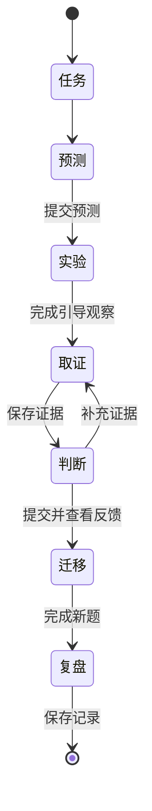
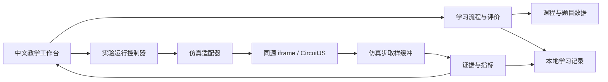

# MCU 电路学习工具：三个案例试点详细设计 v0.1

设计日期：2026-10-14  
依据：[需求分析与方案选型报告](./需求分析与方案选型报告.md)  
范围：路线 C，中文教学界面＋CircuitJS；分压带载、RC、I²C 三个案例。  
历史状态：v0.1 设计基线。以下描述当时的三课试点，不代表当前十二课范围。

实施更新（2026-10-15）：内核已固定为 `8ee04b18a6c9241675f1c4f766617806c2fe148d`，应用已推进至 MVP 0.5；课程仍为 0.4/schema 4，新增独立沙盒项目。当前范围见 [课程能力矩阵](./docs/项目进展与课程能力矩阵.md)，沙盒设计见 [v0.5 详细设计](./docs/沙盒详细设计与项目计划-v0.5.md)。原始设计保留用于追溯；实际验证结论见各版验收报告。

## 1. 本次交付的产品定义

产品暂称“电路直觉实验室”。用户是一名熟悉 MCU 软件、较少接触硬件的工程师。主要使用场景是在桌面浏览器里，花 20–30 分钟完成一个工程问题的分析。

**三个案例必须都能走完：现象 → 预测 → 实验 → 选择测点 → 判断并解释 → 新题迁移 → 保存复盘。** 每个案例提供引导实验和一组未知原因诊断题。平台帮助用户建立电路分析习惯，不承诺达到完整硬件设计能力。

### 1.1 试点包含的能力

| 能力 | 本次具体表现 |
|---|---|
| 静态直觉 | 解释分压为何带载变化，能分清节点电位与两端电压 |
| 时间直觉 | 理解 RC 的建立过程，能判断短脉冲是否跨过门限 |
| 接口直觉 | 用边沿、门限和灌电流分析 I²C 开漏总线 |
| 测量决策 | 为至少两种候选原因选择能区分它们的测量或受控操作 |
| 工程迁移 | 指出真实 MCU、接口器件或仪器中还需要查哪些参数 |

### 1.2 冻结范围

纳入：3 个案例、每案例 1 个引导流程、2 个诊断变体、2 道迁移题；共用节点/支路测量、波形捕获、分级提示、本地记录及 JSON 导出/导入。

后置：另外 9 个课程、PCB 专题、完整原理图编辑器、任意电路导入、元件库管理、MCU 固件执行、协议解码、AI 导师、账号和云端同步、手机适配、在线发布、Service Worker 离线安装。

运行方式：项目资源安装完成后，通过本地 HTTP 服务使用。运行期间不依赖外部 CDN；外部参考资料可以通过链接打开。静态资源可打包，但双击 HTML 文件直接运行不属于支持方式。

## 2. 学习流程和评价

### 2.1 单次学习流程

| 阶段 | 用户行为 | 系统行为 | 进入下一阶段的条件 |
|---|---|---|---|
| 认识任务 | 阅读现象、标称条件、候选原因 | 显示简化电路与当前目标，隐藏结果 | 用户确认理解任务 |
| 提交预测 | 选择趋势/可能原因、依据、置信度 | 保存初始答案，暂不揭晓 | 提交有效选项；允许“不确定” |
| 引导实验 | 改一个变量，运行，观察 | 限制合法参数，产生同一来源的数值与波形 | 完成指定观察，不要求第一次就答对 |
| 诊断取证 | 选择测点、参考点、预期与测量目的 | 显示结果，记录为证据；按需提供提示 | 至少保存一条有效证据 |
| 提交判断 | 选择原因、关联证据、判断其他原因 | 分项评价，不只看最终原因是否选对 | 提交后揭晓；不足项可重试 |
| 迁移检查 | 回答新参数/新画法问题 | 不展示即时提示，提交后反馈 | 完成 2 道题，可标记仍需复习 |
| 复盘 | 写下一句话：下次先检查什么 | 保存记录、错因和建议复习点 | 记录写入成功或明确提示暂存状态 |

预测错误不阻止学习；“完成课程”和“通过能力检查”分别显示。正式迁移题不允许在答题前查看同题结果，提交后可以开放实验验证。

诊断阶段先选择“这次测量想区分什么”，再显示读数；无法区分原因的测量仍允许执行，但不奖励为充分证据。不用“点击越少越好”作为评分标准。

### 2.2 两套互相独立的状态

学习流程状态与仿真状态分开，避免按下暂停改变答题阶段。以下为建议状态机，不是已实现代码。



仿真状态为 `booting / ready / running / paused / capturing / completed / invalid / failed`。参数提交会产生新 runId；上次结果保留为历史，不得在新实验读数位置继续显示。

### 2.3 判定方式

为适应个人学习，使用人工编写的选择题、证据标签和规则反馈。自由文本用于复盘，不作为唯一的自动判分依据。

诊断按四项分别给出 0–2 分：原因与趋势、测点目的、证据解释、修复建议与边界。每项 2 分表示完整，1 分表示部分正确，0 分表示缺失或矛盾。建议“独立通过”条件为总分至少 6/8，测点与证据解释均不为 0，且未使用直接揭晓答案的提示。

提示分三级：H1 提醒概念；H2 建议测量方向；H3 展示完整分析。提示使用不扣除学习进度，但影响“独立完成”标记。连续失败时提供重做引导，不强制用户卡在同一题。

## 3. 界面和交互设计

### 3.1 页面

| 页面 | 内容 | 主要操作 |
|---|---|---|
| 学习首页 | 三个案例、前置关系、进度与复习提醒 | 开始/继续、查看记录 |
| 实验工作台 | 任务、原理图、参数、测量、波形、证据 | 预测、运行、捕获、测量、提交 |
| 复盘页 | 初始预测与最终判断对照、证据、错因 | 重试、查看迁移题、导出 |

默认按分压 → RC → I²C 排列，允许主动进入任意案例，但显示所需基础。支持刷新恢复到最近保存的任务；仿真重新从初始条件启动，恢复历史结果不等于恢复求解器内部状态。

### 3.2 工作台布局

```text
┌───────────────────────────────────────────────────────────┐
│ 案例名      任务 / 预测 / 实验 / 取证 / 判断 / 迁移 / 复盘 │
├──────────────────────────────────────┬────────────────────┤
│ 原理图：输入、输出、GND 与关键支路   │ 当前问题           │
│ CircuitJS 电位与电流动画             │ 预测 / 假设 / 提示 │
│                                      │ 少量合法参数       │
├──────────────────────────────────────┼────────────────────┤
│ 波形：固定坐标、门限线、游标         │ 测点与参考点       │
│ 仿真时间与事件标记                   │ 保存证据 / 判断    │
├──────────────────────────────────────┴────────────────────┤
│ 证据记录：测量目的、条件、结果、仿真时间、运行编号        │
└───────────────────────────────────────────────────────────┘
```

首期用节点/支路下拉选择器作为双探针入口，原理图中的标签与选择器同名。无需在 iframe 上开发坐标命中和拖拽表笔。电压显示 `V(红端) − V(黑端)`，交换表笔改变符号；电流显示声明的参考方向。

波形展示最多 3 条曲线；固定范围，用户主动缩放时保留标记。对比数据以相同触发事件对齐，同时保留原始仿真时间和参数摘要。颜色配合名称与线型；数值统一使用 V、mA、ms、ns、kΩ、pF/µF。

### 3.3 隐藏原因但保留可观察现象

引导模式显示实际教学参数。诊断模式只显示标称条件与候选原因，隐藏用于出题的真实参数值和答案解释。电位颜色与实际测量可见，是题目允许的观测。

诊断时关闭内核元件值显示，阻止 iframe 内编辑和悬浮信息操作，使用外层控件测量；保留必要的标称标签。接口预研需要确认内核波形图例不会泄露参数；若泄露，诊断只使用外层捕获波形。不能仅在侧栏隐藏数值，却让原理图标注真实故障值。

客户端仍可被开发者工具查看，本工具不是防作弊考试系统。这里隐藏答案是为了支持学习流程，不承诺保密。

## 4. 三个电路案例详细设计

所有数值为教学模型的解析参考，尚未经本项目仿真实测。用户界面中，实时观测必须来自 CircuitJS；解析公式仅用于核验、参数步长规划以及明确标注的解释卡。

### 4.1 L01：分压带载

**问题：两个相等电阻可以把 3.3 V 分成 1.65 V，为什么接入一个模块后只有 1.1 V？**

电路：VIN → R1 → VOUT → R2 → GND，外部模块等效 RL 接在 VOUT 与 GND 之间。正常电源为理想 3.3 V。测点：VIN、VOUT、GND；支路：R1、R2、RL，方向分别为 VIN→VOUT、VOUT→GND。

| 项目 | 规定 |
|---|---|
| 默认值 | R1 = R2 = 10 kΩ；开始时 RL 断开 |
| 教学预设 | R1/R2 成对取 1/10/100 kΩ；RL 断开、10/47/100 kΩ |
| 操作 | 接入/移除模块，改变成对电阻，交换测量端点 |
| 静态结果 | 空载 1.65 V；RL=10 kΩ 时 1.10 V |
| 电流参考 | 空载 R1/R2 各 0.165 mA；带载 R1=0.220 mA、R2=RL=0.110 mA |
| 功率参考 | 空载总功率 0.5445 mW；带载总功率 0.726 mW |
| 模型边界 | 理想电源、固定电阻、理想高阻电压探针；无 ADC 采样过程 |

引导步骤：先预测接入负载后的方向；运行对比；测 VOUT 对 GND 和 R1 两端；观察支路分流；保持分压比降低 R1/R2，检查带载误差与功耗的取舍。

诊断变体使用确定性题目 seed：

| 变体 | 实际变化（答题前隐藏） | 初始现象 | 可区分原因的证据 |
|---|---|---|---|
| D1 | R1 错装为 20 kΩ；模块输入高阻 | VOUT=1.10 V | VIN 正常；移除模块仍 1.10 V；R1 电流约 0.110 mA |
| D2 | R1/R2 正常；模块等效 RL=10 kΩ | VOUT=1.10 V | VIN 正常；移除模块回到 1.65 V；接入时 R1 电流约 0.220 mA |

两题的外观均显示标称 R1/R2=10 kΩ、模块输入特性待确认。只测 VOUT 不足以确定原因。诊断操作记录模块连接状态；重新开始同题恢复原 seed 和初始连接，不随机更换答案。

迁移题：① 5 V、上下臂各 22 kΩ、并接 22 kΩ 负载，判断输出由 2.5 V 降到约 1.667 V；② 相同比例下减小分压电阻，解释负载影响减小但静态电流增加。第②题检查两项取舍，不能只答“越小越好”。

工程卡：实际下一级输入阻抗、输入漏电、ADC 采样保持、电压范围；读数偏低时先验证输入电源与负载状态。

### 4.2 L02：RC 响应与短脉冲

**问题：为了滤掉毛刺而增大 RC，为什么有效脉冲也可能检测不到？**

电路：VIN → R → VC，C 接 VC 与 GND。输入使用受控阶跃或矩形脉冲，输出接理想高阻测点。逻辑门限线先作为图表判定，不加入真实 MCU 内部模型。

| 项目 | 规定 |
|---|---|
| 默认值 | 3.3 V 阶跃，R=10 kΩ，C=1 µF，初始 VC=0 V |
| 教学预设 | R=4.7/10/22 kΩ；C=0.47/1/2.2 µF；脉宽=2/10/30 ms |
| 门限假设 | 低界 0.99 V，高界 2.31 V；中间显示“不保证判定” |
| 参考值 | τ=10 ms；t=τ 时 VC≈2.086 V；t=5τ 时 VC≈3.278 V |
| 短脉冲参考 | 默认 RC、2 ms 脉冲，峰值约 0.598 V |
| 跨高门限参考 | 默认阶跃约 12.040 ms 跨过 2.31 V |
| 捕获窗口 | 阶跃覆盖 5τ；脉冲覆盖结束后 5τ，最长约 0.30 s |
| 最大仿真步长 | 不大于 τ/200 和脉宽/100 中适用的较小值；以收敛核验调整 |

门限是教学假设，不代表所有 MCU 的输入门限。首期不做完整迟滞器件仿真；用户先掌握建立时间与脉宽关系，施密特与按键弹跳留给后续课程。

引导步骤：预测 R 翻倍的影响；捕获充放电；在 τ、5τ 处读值；比较 2 ms 和 30 ms 脉冲；根据门限判断“输出是否达到保证高电平区域”，并解释滤波与响应速度的取舍。

诊断两种原因：D1 的 R 错装为 22 kΩ；D2 的输入脉冲幅度只有 1.8 V；其余标称 R=10 kΩ、C=1 µF、脉宽 30 ms 相同。二者均可能表现为“在预定的 15 ms 观察时刻尚未到达 2.31 V”。有效证据是同时观察 VIN 和 VC：输入幅度不足与建立速度过慢可区分。不能仅凭“未跨门限”确定原因。

迁移题：① R=22 kΩ、C=1 µF、10 ms 脉冲，峰值约 1.205 V，不能进入保证高电平区域；② 在参数变化后选择 VIN、VC 和门限作为有效观察量，解释为何只看最终稳态值不足以评价短脉冲。

工程卡：目标 MCU 的输入门限、最小脉宽、采样时刻、复位输入特性。工具不把一个 RC 电路视为所有芯片的通用复位方案。

### 4.3 L03：I²C 上拉、总线电容与灌电流

**问题：通信速率提高后出现异常，应怎样检查总线的模拟边沿？**

只仿真一根开漏线的周期性拉低/释放，展示模拟电压和参考时序；不执行地址、数据、ACK、时钟延展、仲裁或真实 MCU 固件。结果文字为“本模型的边沿/电平是否满足所选约束”，不显示“协议通信一定成功”。

电路：3.3 V → RP → BUS；CB 接 BUS 与 GND；开关支路接 BUS 到 GND。拉低路径包含固定 100 Ω 教学导通电阻，释放路径足够高阻。RP、CB 和驱动控制均由 CircuitJS 电路求解，不能用预画的指数曲线替代。

| 项目 | 规定 |
|---|---|
| 教学预设 | RP=470 Ω/1/2.2/4.7/10 kΩ；CB=50/100/200 pF |
| 默认 | RP=4.7 kΩ、CB=100 pF、3.3 V |
| 时序 | 100 kHz 或 400 kHz，教学驱动 50% 占空比，至少捕获两次完整拉低/释放 |
| 门限线 | 0.3VDD 和 0.7VDD，用于本实验的 30%–70% 上升时间测量 |
| 边沿约束 | Standard-mode 1000 ns；Fast-mode 300 ns |
| 额外教学约束 | 灌电流能力上限按 3 mA、VOL 检查按 0.4 V；显式声明假设 |
| 默认解析参考 | tr≈398.231 ns；低态≈0.06875 V；低态电流≈0.6875 mA |
| 过强上拉示例 | RP=470 Ω 时，模型低态≈0.579 V，电流≈5.789 mA，两项告警 |

100 Ω 是教学等效电阻，并非来自某一款器件。超过 3 mA 时，模型仍按等效电阻求解，只能说明超出所声明能力，不预测器件真实限流、损坏或温升。

按一阶释放模型，tr≈0.8473RP·CB；上拉选型需同时约束边沿与低态能力。数值依据见 [TI：I²C 上拉计算](https://www.ti.com/lit/an/slva689/slva689.pdf)。工具使用自己的电路与图示，不复制厂商图表。

引导步骤：预测减小 RP 的影响；捕获 30%–70% 边沿；改 CB 和模式作比较；再试 RP=470 Ω，同时测低态电压和电流；最后选出一个兼顾约束的方案。

诊断两种原因：D1 的等效 RP=9.4 kΩ（例如两只 4.7 kΩ 串联），CB=100 pF；D2 的 RP=4.7 kΩ，CB=200 pF。两者 RC 同为 0.94 µs，释放段 30%–70% 边沿近似相同。为核实原因，需要低态电流或其他有区分力的证据：模型约为 0.347 mA 与 0.688 mA。不能只凭慢边沿断言“上拉电阻过大”。

若某次高电平窗口内未跨过 70%，标记“本次窗口未形成完整上升时间”，不能补出 70% 交点或显示合格。可在解释卡显示明确标注的解析估算，并建议延长释放窗口验证。

迁移题：① RP=2.2 kΩ、CB=150 pF，解析 tr≈279.609 ns，在上述假设下满足 300 ns 且模型低态电流约 1.435 mA；② 仅降低通信速率是否等于修复了灌电流超限，正确回答为需要分别检查。

工程卡：实际器件的 VOL/IOL、输入门限、实际总线电容、模式要求、探头负载。协议报错需要更多证据；本实验只训练电气侧排查。

## 5. 技术架构和依赖选择

建议使用 TypeScript＋React＋Vite，课程文件使用 JSON 与对应运行时校验；单元验证采用 Vitest，浏览器验收采用 Playwright。具体依赖版本在开发初始化时按兼容组合锁定，本轮不指定未经安装验证的版本。



教学页面、仿真器、课程、电路和字体都由同一个本地 HTTP 服务提供，避免跨域状态读取。首期固定一个内核，不建设多内核平台。

### 5.1 上游选择的细化

原报告引用了 `sharpie7/circuitjs1`。本轮继续核对后，将 Falstad 官网所链接的 `pfalstad/circuitjs1` 作为优先候选；它的上游源码包含独立 JSInterface。该选择是路线 C 的实现细化，不是更换产品路线。[Falstad 官网](https://www.falstad.com/circuit/)，[候选源码仓库](https://github.com/pfalstad/circuitjs1)。

预研必须选定具体 commit SHA，并记录源代码、构建方法、产物校验值、许可证与补丁。当前 master 只能作为文档调研对象，不能作为运行时自动更新源。若预编译资源与已核对源码不对应，应从锁定源码构建，或选择另一个已验证提交。

### 5.2 文档/源码能力与运行验收分开

下面的上游方法和回调在本轮查看的源码/示例中存在，实际语义、时序与可用性仍须 G0 验证。

| 需求 | 候选上游接口 | 验证重点 |
|---|---|---|
| 就绪通知 | `oncircuitjsloaded` | 初始加载竞态、已初始化时的补查 |
| 运行与暂停 | `setSimRunning`、`isRunning` | 暂停后时间停止推进 |
| 时间与步长 | `getTime`、`getMaxTimeStep`、`setMaxTimeStep` | 单位、上限生效、回调内暂停偏差 |
| 节点读数 | `getNodeVoltage` | 标签准确；缺失标签不可当作 0 V |
| 元件与支路 | `getElements`；元件电流/端电压方法 | 类型、数量、方向、实例重载后的重新映射 |
| 重载电路 | `importCircuit`、`onanalyze` | 分析完成、初始条件、旧引用失效 |
| 高速取样 | `ontimestep` | 调用位置、样本时间、求解结束语义 |
| 画面更新 | `onupdate` | 只用于刷新，不作为精密取样来源 |

接口依据：[上游 JSInterface](https://raw.githubusercontent.com/pfalstad/circuitjs1/master/src/com/lushprojects/circuitjs1/client/JSInterface.java)，[上游接口示例](https://raw.githubusercontent.com/pfalstad/circuitjs1/master/war/jsinterface.html)。源码对 `setTimeStep` 有避免使用的注释，本设计只计划通过最大步长入口控制求解精度。

### 5.3 自有适配器契约

以下是项目拟定义的接口，不声称上游直接提供同名函数：

```ts
interface CircuitAdapter {
  boot(): Promise<Capabilities>;
  load(input: RunInput): Promise<RunHandle>;
  start(runId: string): void;
  pause(runId: string): void;
  hardReset(input: RunInput): Promise<RunHandle>;
  readSnapshot(runId: string): Snapshot;
  subscribeSteps(handler: (sample: StepSample) => void): () => void;
  dispose(): void;
}
```

参数变更优先通过固定拓扑模板生成新的完整电路，并重新加载；本期不依赖通用的元件实时修改 API。模板只能替换显式参数槽，校验单位与范围，不用全局字符串替换修改任意数字。内核电路格式由锁定版本决定，本轮不预设其一定使用旧文本或 XML 格式。

节点优先通过唯一标签读取；支路通过课程映射到固定模板元件实例，核对类型、端点和数量。引导/诊断均禁止任意编辑，因此可使用版本化的模板位置映射。重载后重新建立映射，不跨 run 复用元件对象。

缺失标签、重复匹配和非有限数值均产生明确错误。禁止用默认 0 来兜底，因为 0 V 可能是正常测量结果。

### 5.4 操作事务与复位

每次参数提交：暂停旧 run → 生成新 runId → 清空当前捕获状态 → 校验电路 → 加载 → 等待就绪与重新映射 → 设置最大步长 → 验证初始条件 → 按目标状态启动。

连续调参使用“选择后点击应用”，避免滑块每帧重载。若存在未完成加载，旧请求的回调通过 generation/runId 丢弃。失败时显示错误与重试入口，不能拿旧数据冒充新结果。

硬复位销毁 iframe 并重新创建，从声明的参数、初始条件和同一题 seed 开始。API 重载可以作为验证后的优化，但必须证明与硬复位一致。重新做题与重新开始仿真分别操作；复位不删除历史证据。

### 5.5 数值、动画与解释的来源

内核电位颜色和电流动画继续使用 CircuitJS 渲染。双探针读数、支路数值、捕获曲线和自动反馈读取同一 run 的求解状态。解析参考只能显示在解释/核验区域，并清楚标注，不能用于伪造实时测量。

外层 UI 不每步更新 React 状态。适配层在仿真回调中保存最少必要信号，UI 按画面更新节奏刷新最新快照和降采样曲线。外层不另画一套与求解器无关的电流动画。

## 6. 波形取样与 I²C 精度控制

### 6.1 两种时间不可混用

`simTime` 是电路时间，单位为秒；墙钟时间只用于加载超时、性能提示与操作记录。测量 RC 和 I²C 上升时间必须使用 `simTime`。图上显示 ns/ms，动画速度另作说明。

对于 I²C，浏览器定时器和显示刷新远慢于边沿。因此 `ontimestep` 收集数值，UI 刷新仅负责显示。该回调到底对应本步已解状态还是下一步输入控制时刻，需要 G0 用已知电路实测确认。

### 6.2 最大步长与缓冲

I²C 预设最大步长取 `min(5 ns, tr参考/50, 驱动周期/500)`；tr参考由当前内部参数的一阶模型规划精度，不能显示为实测值。最小预设 RP·CB 时步长约 0.4 ns。最多捕获两周期及必要的短暂建立过程，目标不超过 100,000 步；超过上限提示缩小窗口，不静默降精度。

RC 使用课程定义的步长上限与有限窗口；分压只在稳态检查后保存快照。所有捕获记录实际最大时间间隔，便于发现步长设置未生效。

高精度原始数据只保存当前与上一次用于对比的 run，留在内存中；默认本地存储只保存证据快照、少量趋势摘要和判定指标。显示曲线可按 min/max 桶降采样，但门限检测和判定必须在原始样本上完成。缓冲满时停止捕获并提示，不能循环覆盖正在用于诊断的边沿。

### 6.3 上升时间计算

1. 识别驱动从拉低到释放的事件，记录事件所在样本区间。
2. 在该释放段搜索首次向上跨过 0.3VDD 与 0.7VDD 的样本对。
3. 对每个交点做线性插值；`tr = t70 − t30`。
4. 若交点缺失、区间被下一次拉低打断、重复跨越异常或样本间隔过大，标记不完整或不可靠。
5. 判定使用原始精度；显示小数取舍不影响边界判断。

边界附近保留“需提高精度”状态。当误差估计区间与 300/1000 ns 边界相交时，不武断显示通过或失败。释放事件定位、门限交点及最大步长都会保存在证据里。

I²C 的低态电压和电流在拉低后稳定区间采集，避开开关瞬态。定义的电流限制是能力检查规则，不将教学等效电阻外推为真实器件特性。

## 7. 课程、证据和记录的数据设计

### 7.1 内容结构

| 数据 | 关键字段 | 约束 |
|---|---|---|
| Lesson | id、version、目标、前置、steps、工程卡 | 每步声明可用控件和测点 |
| CircuitTemplate | id、version、内核版本、参数槽、节点/支路映射 | 参数单位为 SI，模板与映射一并版本化 |
| ParameterPreset | 参数值、展示标签、允许范围 | 预设之外的输入拒绝进入求解 |
| DiagnosticCase | opaqueCaseId、seed、内部变化、公开条件、候选原因 | 答题前不得显示内部变化 |
| Rubric | 选项、有效证据组合、反馈、提示 | 条件表判定，不执行来自数据的脚本 |
| ReferenceCase | 参数、初始条件、参考值、容差 | 区分解析、仿真和实测来源 |

课程 schema 至少校验步骤引用存在、节点映射唯一、参数合法、每个诊断有区分性证据、每个迁移题有依据、所有题目反馈可达。不做通用可编程课程 DSL。

### 7.2 证据快照

```ts
type Evidence = {
  id: string;
  lessonId: string;
  lessonVersion: string;
  opaqueCaseId: string;
  runId: string;
  engineRevision: string;
  recordedAt: string;             // 操作时间，不用于波形计算
  simTimeSeconds: number;
  purposeId: string;              // 想区分哪种假设
  measurement: {
    kind: 'voltage' | 'current' | 'riseTime' | 'pulsePeak';
    positive?: string;
    negative?: string;
    branch?: string;
    valueSI: number | null;
    status: 'valid' | 'incomplete' | 'unreliable';
  };
  publicConditions: Record<string, number | string | boolean>;
  learnerInterpretation?: string;
};
```

对照证据必须是不可变快照，不能在参数改动后自动替换数值。后台内部 run 可保留真实条件用于复现；公开证据只显示题目允许的信息。答题后复盘可揭示实际参数及解释。

### 7.3 本地持久化

使用 localStorage 保存小规模学习记录，带 `schemaVersion`。只在提交答案、保存证据、完成步骤等语义事件时写入；不按仿真步写入。

保存内容包括：课程版本、进度、当前步骤、答案、置信度、提示记录、证据、复盘、题目 seed 与运行参数摘要。默认不持久化高精度原始波形，也不恢复电容历史状态。

提供 JSON 导出/导入；导入先校验版本、大小、字段和值，失败不覆盖原记录。新课程版本保留旧记录并显示版本标签，不把旧成绩自动标成新版本通过。存储不可用时继续学习，明确显示“本次记录仅暂存内存”并提供导出。

## 8. 异常与边界处理

| 异常 | 系统表现 | 恢复方式 |
|---|---|---|
| 仿真器未就绪 | 参数/测量不可用，显示加载状态 | 首次 10 s 超时提示；重试重新创建 iframe |
| 标签/支路映射错误 | 不显示该读数为 0，不允许凭此判题 | 记录诊断信息，重新载入；仍失败标记案例不可用 |
| 参数越界 | 就地说明合法预设与单位 | 不改变当前有效 run |
| 非有限值或求解停止 | 终止捕获，结果标记无效 | 保留历史证据，允许硬复位 |
| 波形未到门限 | 显示未形成完整边沿 | 延长允许窗口或修改参数；不伪造交点 |
| 标签切换/页面隐藏 | 暂停运行并提示 | 用户返回后主动继续或重新捕获 |
| 存储失败 | 学习继续，显示未持久化 | 导出，不静默宣称已保存 |
| 错误提示/答案提前可见 | 属于课程缺陷 | 修正诊断模式后重新验收 |

内核没有统一的结构化错误出口时，预研须明确可用检测途径。外层可检查时间推进、有限值与运行状态，但不能只凭 `isRunning=false` 判定不收敛，因为主动暂停也会停止。

## 9. 验证设计

### 9.1 数值与趋势基线

| 基线 | 参考 | 初始验收容差 |
|---|---|---|
| 分压空载、带载、错值 | 1.65/1.10/1.10 V | 电压绝对误差 ≤5 mV；支路电流相对误差 ≤1% |
| 分压支路收支 | IR1=IR2+IRL | 残差 ≤1 µA；方向与符号正确 |
| RC 在 τ 与 5τ | 2.086/3.278 V | 电压误差 ≤20 mV；到门限时间误差 ≤1% |
| RC 2 ms 脉冲峰值 | 0.598 V | 误差 ≤20 mV；初始条件重复一致 |
| I²C 默认 tr | 398.231 ns | 与一阶模型相对偏差 ≤3%，最大步长减半后变化 ≤1% |
| I²C 两个诊断变体 | 约 796.462 ns、低态电流约 0.347/0.688 mA | tr 偏差 ≤3%；稳定区间电流偏差 ≤1% |
| I²C 过强上拉 | 0.579 V、5.789 mA | 数值偏差 ≤2%；必须提示超出假设能力 |

容差是初始目标，G0/G1 根据锁定内核的积分与开关模型确认。若不能达到，应调整步长/初始条件/模型，或说明限制并修订设计；不能在代码中任意放宽断言以通过测试。

主要测试对象是具有风险的数值读取、门限检测、状态事务、记录恢复与教学判定，不为颜色、文案或每个组件编写机械性测试。

### 9.2 浏览器与端到端验收

主验收环境：当前开发机上的 Chromium 浏览器，桌面宽度 1280 px 及以上；Safari 做三案例核心流程兼容检查。浏览器实际版本在验收记录中注明。小屏提供明确布局提示，完整手机体验后置。

至少覆盖：三案例全流程；错误预测后继续；H1/H2/H3；变参不残留旧数据；硬复位；交换表笔；切换题目；缺失映射；未跨门限；中途刷新；存储失败；导入异常；无网络运行静态资源；诊断参数不泄漏到正常 UI。

性能目标为设计目标：本地资源冷启动一般不超过 5 s；预设切换至 ready 一般不超过 1 s；最长预设捕获以 5 s 为初始交互目标。若细步长导致明显卡顿，优先减少捕获周期和信号数量；不可用牺牲数值精度换取表面流畅。

### 9.3 学习验收

用相同能力点的不同题做前测和后测，不直接重复已讲答案。用户能走完流程、解释有区分力的测量，并在每案例 2 道迁移题中至少独立完成 1 道，作为试点的初始学习目标。

一周后换新参数再做简短检查。单人结果只用于决定是否继续扩建，不能据此声称工具具有普遍的提速比例。技术完成、流程可用、学习收益分别记录；个人第一次未通过题目不会自动变成软件缺陷。

## 10. 交付目录与设计决策

建议开发目录如下，仅是规划，本轮不创建空代码工程：

```text
src/
  app/                 页面和布局
  learning/            学习状态、题目评价、提示
  experiments/         run 事务、捕获和证据
  simulation/          CircuitJS 适配、映射、生命周期
  measurement/         差分电压、门限与指标
  persistence/         本地记录和导入导出
content/
  lessons/             三案例课程
  circuits/            固定拓扑模板
  diagnostics/         题目变体与判定
  references/          数值参考与模型说明
public/vendor/circuitjs/ 固定版本编译资源
tests/                  数值、事务和关键端到端验证
docs/                   预研、构建、验收、来源与补丁记录
```

| 决策 | 理由 | 允许重新评估的条件 |
|---|---|---|
| 固定三个案例 | 小范围验证完整学习闭环 | 用户试学与迁移结果支持扩展 |
| 复用内核画图 | 避免重写原理图渲染 | 现成图无法表达关键教学信息 |
| 模板重载参数 | 不依赖通用实时修改接口 | 重载体验成为主要障碍且接口已验证 |
| 每步取样、低频刷新 | I²C 时间尺度与浏览器刷新差异很大 | 必须保留测量精度 |
| 单前端、本地运行 | 与个人学习场景匹配 | 用户另有发布、多端或多人使用需求 |
| 确定规则评价 | 可核验、易解释、无需外部服务 | 自由文本评价确有价值且可验证 |

CircuitJS 许可证与源代码、构建和改动记录随项目保存；发布或再分发按实际使用方式处理。本次计划仅本地交付，不安排外部发布。文档中的示例接口与目录是设计建议，不能作为已经完成实现的证据。
